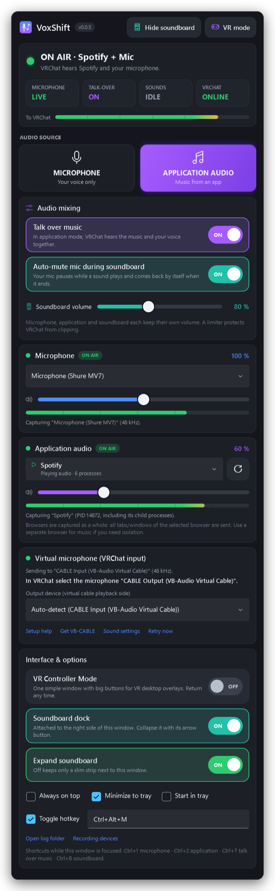
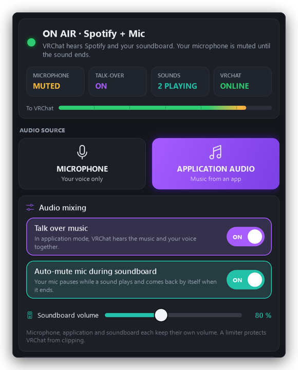
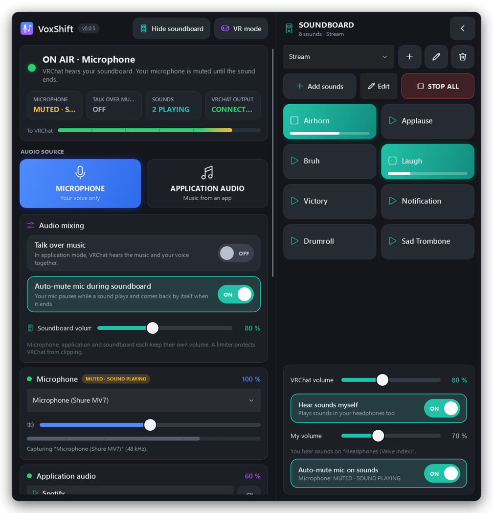
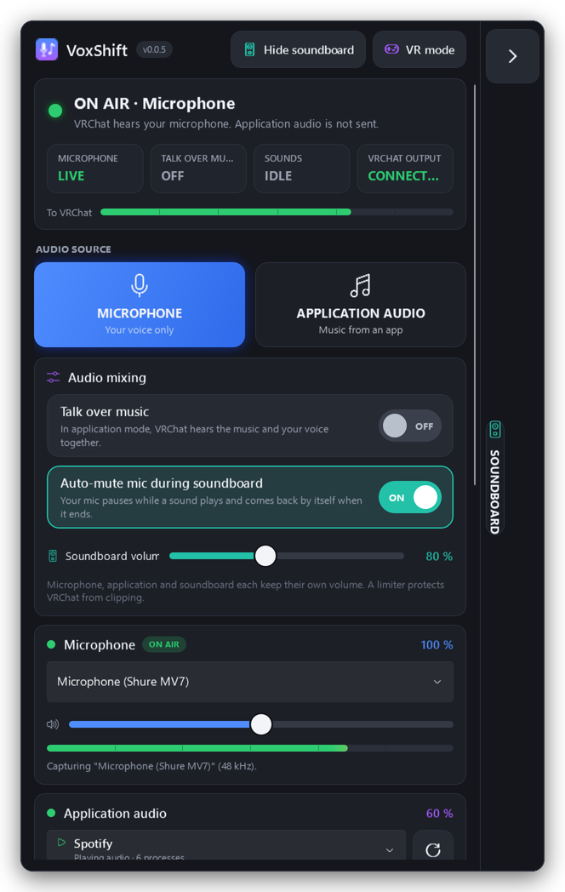
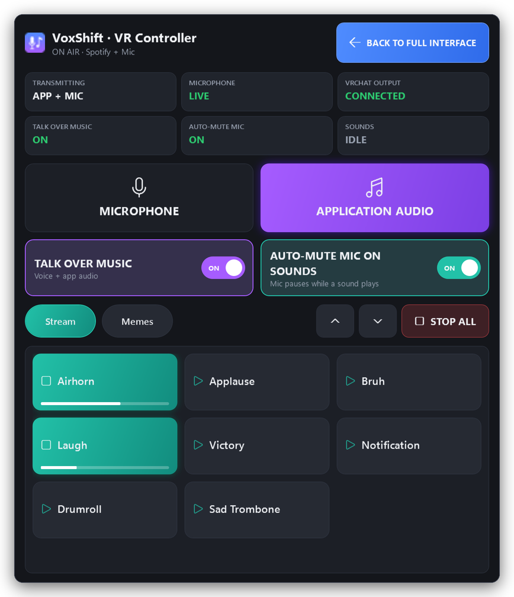
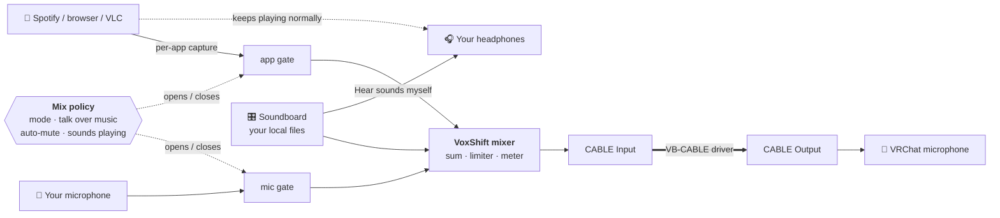

<p align="center">
  
</p>

<h1 align="center">VoxShift</h1>

<p align="center">
  <b>The VR-friendly audio switcher and soundboard for VRChat.</b><br>
  Send <b>your microphone</b>, <b>the music of one application</b> (Spotify, YouTube in your browser, VLC, …) or
  <b>both at once</b> into VRChat, fire off sounds from a <b>local soundboard</b> that sits right next to the window,
  and let VoxShift <b>mute your mic automatically while a sound plays</b>. Big buttons and a dedicated
  <b>VR Controller Mode</b> make it easy to use with a headset on.
</p>

<p align="center">
  <a href="https://github.com/crapclap161/voxshift/releases/latest"></a>
  <a href="https://github.com/crapclap161/voxshift/actions/workflows/ci.yml"></a>
  
  <a href="LICENSE"></a>
</p>

<p align="center">
  <a href="#-quick-start"><b>Quick start</b></a> ·
  <a href="#-features"><b>Features</b></a> ·
  <a href="#smart-microphone-muting"><b>Smart muting</b></a> ·
  <a href="#talk-over-music"><b>Talk over music</b></a> ·
  <a href="#dockable-soundboard"><b>Soundboard</b></a> ·
  <a href="#vr-controller-mode"><b>VR Controller Mode</b></a> ·
  <a href="#-troubleshooting"><b>Troubleshooting</b></a>
</p>

<p align="center">
  
</p>

<p align="center"><sub>The redesigned main window with the <b>soundboard docked on its right</b>. Two sounds are playing, so
VoxShift has <b>muted the microphone automatically</b>; it comes back by itself when they end. Rendered from the real
WPF UI with sample devices and sounds.</sub></p>

---

## ✨ Why VoxShift?

- 🎚️ **One click, no fiddling.** Point VRChat's microphone at the virtual cable once. Every switch after that happens in
  VoxShift, instantly and without restarting VRChat.
- 🎤🎵 **Voice, music or both.** Microphone mode sends only your voice. Application mode sends only your music. Turn on
  **Talk over music** and VRChat hears your music *and* your voice, mixed safely with separate volumes.
- 🤫 **Smart microphone muting.** Press the air horn and your mic pauses while it plays, then returns the moment the
  last sound ends. No extra clicks. Only VoxShift's mix is affected; Windows, Discord and other apps are untouched.
- 🎛️ **A soundboard that docks to the window.** It opens as its own panel attached to the right side of VoxShift,
  follows the window, and collapses into a slim strip when you don't need it.
- 🥽 **Made for VR controllers.** Large buttons, obvious ON/OFF states, no right-click needed, and an optional
  **VR Controller Mode** that reduces everything to one simple window for VR desktop overlays.
- 🎯 **Only that app, only your files.** VoxShift captures just the selected program, not your desktop, and plays your
  sound files straight from where they are. Nothing is copied or uploaded.

## 🚀 Quick start

| | Step |
|:-:|---|
| **1** | Install the free **[VB-CABLE](https://vb-audio.com/Cable/)** driver (`VBCABLE_Setup_x64.exe` → *Run as administrator* → *Install Driver*) and **reboot**. |
| **2** | Download **`VoxShift-v…-win-x64-portable.exe`** from the **[latest release](https://github.com/crapclap161/voxshift/releases/latest)** and run it. It's portable: no installer, no .NET, nothing to extract. (A ZIP with docs is available too.) |
| **3** | Choose your **microphone** and the **application** to share (start it first, then press ⟳ or F5), and set the volumes. |
| **4** | In VRChat: **Settings → Audio & Voice → Microphone → `CABLE Output (VB-Audio Virtual Cable)`**. You only do this once. |
| **5** | Press **🎤 MICROPHONE** (Ctrl+1) to talk and **🎵 APPLICATION AUDIO** (Ctrl+2) to play music. Want to talk over the music? Turn on **Talk over music** (Ctrl+T). |
| **6** | Drag audio files onto the **SOUNDBOARD** on the right and click a button to play it into VRChat. Your mic mutes itself while it plays. |
| **7** | Wearing your headset? Click **VR mode** for big, simple controls in your VR desktop overlay. |

> [!TIP]
> Turn **off VRChat's Noise Suppression** while playing music, because it treats music as noise.
> If **LIMIT** lights up next to the *To VRChat* meter, lower a volume a little.

> [!NOTE]
> `VoxShift.exe` isn't code-signed yet, so SmartScreen may show *“Windows protected your PC”*. Choose
> **More info → Run anyway**, and verify the download against `SHA256SUMS.txt` from the release.

## 🖥️ The interface

<p align="center"></p>
<p align="center"><sub>Application audio mode with <b>Talk over music</b> on: VRChat hears Spotify and your voice. The status
chips show what is <i>actually</i> transmitted right now.</sub></p>

From top to bottom:

1. **Status**: what VRChat hears right now in one sentence (*“VRChat hears Spotify and your microphone.”*), plus four
   large chips: **Microphone** (LIVE / MUTED · SOUND PLAYING / OFF), **Talk over music**, **Sounds** and **VRChat
   output**, and the *To VRChat* level meter. The chips always show the *effective* state, not just your settings.
2. **Audio source**: two big buttons, **MICROPHONE** and **APPLICATION AUDIO**.
3. **Audio mixing**: the **Talk over music** and **Auto-mute mic during soundboard** switches, and the soundboard
   volume.
4. **Microphone** and **Application audio** cards with device pickers, 0–200 % volume sliders and live meters.
5. **Virtual microphone**: VB-CABLE status and setup help.
6. **Interface & options**: VR Controller Mode, soundboard dock visible / expanded, always on top, tray and hotkey.

The **Show soundboard** and **VR mode** buttons in the title area are always visible.

| Option | What it does | Default |
|---|---|---|
| 🎤 **Microphone mode** | VRChat hears your microphone. Application audio is never sent. | on |
| 🎵 **Application audio mode** | VRChat hears the selected application. Your mic is sent only with *Talk over music*. | |
| 🎙️ **Talk over music** | In application mode, VRChat hears the application **and** your microphone. | off |
| 🤫 **Auto-mute mic during soundboard** | Your mic pauses while a soundboard sound plays and returns when it ends. | on |
| 🎛️ **Soundboard dock** | Shows the soundboard attached to the right of the window. | on |
| 🥽 **VR Controller Mode** | Replaces the full interface with one simplified window. | off |

<a id="smart-microphone-muting"></a>
## 🤫 Smart Microphone Muting

When you click a soundboard sound, VoxShift **automatically mutes your microphone's contribution to VRChat**, plays
the sound, and **brings your microphone back as soon as the sound has completely finished**. You keep talking, click
*Airhorn*, VRChat hears the air horn without your voice over it, and a moment after it ends your voice is back. No
extra clicks.

- **It follows the real playback**, not a timer: the mixer itself reports when the last sound has finished.
  Overlapping sounds keep the mic muted until the *last* one ends. **Stop all**, stopping a single sound, a sound that
  fails or a device that disconnects all release the mute correctly, so the mic is never left muted by accident.
- **No pops, no leaks.** The microphone fades out within 8 ms of the click and fades back in over 30 ms. A 100 ms hold
  between quickly repeated clicks keeps your voice from flickering in between.
- **Always up to date.** If you change the mode, *Talk over music* or the auto-mute switch while a sound plays, VoxShift
  recalculates what VRChat should hear from your current settings. It never restores an outdated state.
- **Only inside VoxShift.** Your Windows microphone is never muted and no system setting is changed, so Discord and
  other apps keep hearing you normally.
- **Music keeps playing.** In application mode with *Talk over music*, only the microphone pauses. Spotify and the
  sound carry on.
- **You still hear your sounds.** Headphone monitoring (*Hear sounds myself*) is not affected.

**Toggle it** with **Auto-mute mic during soundboard** in the *Audio mixing* card, with **Auto-mute mic on sounds** at
the bottom of the soundboard dock, with **AUTO-MUTE MIC ON SOUNDS** in VR Controller Mode, or from the tray menu. It is
**on by default**. Turn it off if you want to talk over your sounds.

<a id="talk-over-music"></a>
## 🎙️ Talk Over Music

By default VoxShift is a clean switch: application mode sends **only** the music. Turn on **Talk over music** to DJ,
play Spotify for your friends or stream music while you speak:

1. Select the music application (e.g. Spotify) and press **APPLICATION AUDIO**.
2. Turn on **Talk over music** (Ctrl+T, the *Audio mixing* card, VR Controller Mode or the tray menu).
3. Talk normally. VRChat hears the music and your voice together.

Turn it **off** again to go back to music only. Your microphone then never leaks into application mode.

- **Volumes stay independent.** The microphone slider sets your voice, the application slider sets the music
  (0–200 % each), and the soundboard has its own slider. Lower the music a bit so your voice stays clear.
- **Safe mixing.** Voice, music and sounds are summed once and pass through VoxShift's −1 dBFS peak limiter, so even
  everything at 200 % never clips harshly. The *To VRChat* meter shows the final mix.
- **Microphone mode is unaffected.** It still sends only your voice; application audio never leaks into it.
- **Smooth switching.** With Talk over music on, switching from microphone to application mode keeps your voice
  continuously on air while the music fades in.
- **With the soundboard:** if *Auto-mute* is on, a sound temporarily mutes only your voice; the music keeps playing.
  If *Auto-mute* is off, VRChat hears music, voice and sound together.
- Your microphone is never played back into your own headphones, so there is no echo or feedback loop.

### What VRChat hears

| Mode | Talk over music | Sound playing | Auto-mute mic | VRChat hears |
|---|:-:|:-:|:-:|---|
| 🎤 Microphone | – | no | – | microphone |
| 🎤 Microphone | – | yes | **on** | soundboard only (mic muted) |
| 🎤 Microphone | – | yes | off | microphone + soundboard |
| 🎵 Application | off | no | – | application only |
| 🎵 Application | off | yes | – | application + soundboard |
| 🎵 Application | **on** | no | – | application + microphone |
| 🎵 Application | **on** | yes | **on** | application + soundboard (mic muted) |
| 🎵 Application | **on** | yes | off | application + microphone + soundboard |

<p align="center"></p>
<p align="center"><sub>Talk over music and Auto-mute both on, while a sound plays: Spotify continues, the microphone chip
shows <b>MUTED · SOUND PLAYING</b>.</sub></p>

<a id="dockable-soundboard"></a>
## 🎛️ Dockable Soundboard

The soundboard plays **sound files from your PC into VRChat** with one click: air horns, applause, stream alerts, short
jingles. In v0.0.5 it lives in its **own window, docked to the right side of VoxShift**, so it no longer takes space
away from the audio controls.

<p align="center"></p>
<p align="center"><sub>The expanded dock: collection selector, Add sounds / Edit / STOP ALL, large sound buttons (two
playing, with progress bars), VRChat volume, <i>Hear sounds myself</i> and the auto-mute switch.</sub></p>

### Expand, collapse and move it

- **Collapse** with the **◀** button in the dock's header. The dock becomes a **slim strip** next to the main window
  with a large **▶** handle, the number of sounds playing, and a **Stop all** button while sounds play. It never
  covers the main window.
- **Expand** by clicking the **▶** handle or anywhere on the strip.
- **Show or hide** the dock with **Show soundboard / Hide soundboard** in the title area (Ctrl+B) or the *Soundboard
  dock* switch. Closing the dock never closes VoxShift.
- **It follows the main window**: drag VoxShift (or the dock's header) and both move together; resize the main window
  and the dock keeps the same height. Drag the dock's outer edge to make it wider or narrower.
- **Always on screen:** if there is not enough room to the right of VoxShift when you finish moving it, VoxShift slides
  the main window to the left so both fit. On very narrow screens (or a maximized window) the dock stays visible by
  overlapping the main window. Positions are calculated in physical pixels, so it lines up on every monitor and DPI
  setting.
- It minimizes, restores and hides to the tray together with the main window, and follows *Always on top*.
- The expanded/collapsed state, visibility and width are remembered.

<p align="center"></p>
<p align="center"><sub>Collapsed: a slim strip with a large expand handle. Drop files onto it to add sounds.</sub></p>

### Add sounds with drag & drop

1. Open Windows Explorer next to VoxShift.
2. Select one or more audio files, or a whole folder.
3. Drag them onto the soundboard dock. It lights up as a drop target, **also when it is collapsed**.
4. Drop them. A button appears for each new sound right away, and the dock expands.

<p align="center"></p>

- **Your first soundboard is created automatically.** If you have none yet, dropping files creates one called
  *Soundboard*. Otherwise the files go into the selected collection.
- Prefer a dialog? Click **Add sounds** and pick files with the Windows file picker.
- **Supported formats:** WAV, MP3, FLAC, M4A/AAC and WMA. Unsupported files (e.g. `.ogg`), missing files and files
  that are already on the soundboard are skipped, and VoxShift tells you which ones and why.

### Your files stay where they are

> [!IMPORTANT]
> VoxShift **does not copy, move, upload, or modify** imported audio files. The soundboard references and plays the
> original files directly from their local locations, for example `D:\Music\Soundboard\airhorn.mp3`.
> Removing a soundboard entry, or deleting a whole collection, **never deletes the original audio file**.

If you move or rename a file later, its button shows a ⚠ warning instead of failing. Turn on **Edit**, click the
button (or right-click it), choose **Relink file…**, and point it at the new location.

### Play, stop and manage sounds

| Action | How |
|---|---|
| Play a sound | Click its button. Several sounds can play at the same time; a playing button lights up with a progress bar. |
| Stop one sound | Click the playing button again |
| Stop everything | **STOP ALL** (also on the collapsed strip and in VR Controller Mode) |
| Rename, relink, remove, play overlapping | Turn on **Edit** and click a sound, or right-click it. No right-click is needed, which helps with VR controllers. |
| Switch collection | The collection selector at the top of the dock (**＋** new, **✎** rename, **🗑** delete; files are never deleted) |
| VRChat volume | *VRChat volume* slider (0–200 %), independent of the microphone and application volume |
| Hear sounds yourself | **Hear sounds myself** (on by default) also plays every sound in your headphones, with its own *My volume* slider |

### Hear the sounds yourself

| Sound goes to | Volume control | Contains |
|---|---|---|
| VRChat (virtual microphone) | *VRChat volume* | the transmitted sources (see the table above) **+** soundboard |
| Your headphones | *My volume* | soundboard only |

- Only the soundboard is played back to you. Your own microphone is never echoed into your headphones (also not with
  Talk over music), and the captured application plays there as usual anyway.
- Auto-mute never interrupts what you hear: it only mutes the microphone in VRChat's mix.
- VoxShift follows your Windows default playback device and never monitors into the virtual cable. If your Windows
  default playback device *is* CABLE Input, monitoring pauses with a hint, because otherwise VRChat would hear every
  sound twice.

> [!NOTE]
> Each sound is decoded once and kept in memory, up to 5 minutes per sound. Use application mode for long music.

<a id="vr-controller-mode"></a>
## 🥽 VR Controller Mode

Pointing at small buttons with a VR controller through a desktop overlay is hard. **VR Controller Mode** replaces the
full window and the dock with **one simplified window that contains only the most important controls**, all of them
large:

<p align="center"></p>

- **Status tiles**: what is transmitted, whether your microphone is LIVE or MUTED, Talk over music and Auto-mute ON/OFF,
  whether the VRChat output is connected and how many sounds are playing.
- **MICROPHONE** and **APPLICATION AUDIO** as huge buttons, the active one lit up.
- **TALK OVER MUSIC** and **AUTO-MUTE MIC ON SOUNDS** as large ON/OFF switches.
- **Your soundboard**: big collection buttons, a scrollable grid of large sound buttons with playing feedback, **▲ / ▼**
  page buttons (no fiddly scrolling) and **STOP ALL**.
- **BACK TO FULL INTERFACE** in the top right corner (or Esc) returns to the normal window and its docked soundboard.

**Activate it** with the **VR mode** button in the title area, the *VR Controller Mode* switch, or the tray menu.
VoxShift remembers the mode and the window's size and position, and starts in it next time.

**Using it with a headset on:** open your VR desktop overlay (SteamVR's desktop view, Virtual Desktop, OVR Toolkit,
XSOverlay, …), point at the VoxShift window and click with the trigger. The window can be resized; the sound grid
adds columns as it gets wider.

- Switching modes only changes the interface. The audio engine keeps running: music, microphone and playing sounds
  are not interrupted, and no second soundboard or engine is created.
- You can't get stuck: the window's **X** also returns to the full interface, and the tray icon always offers
  **Show full interface**.

> [!NOTE]
> VR Controller Mode is a desktop window designed for **standard Windows pointer input** as provided by VR desktop
> overlays. VoxShift does not integrate with OpenXR, SteamVR or Meta controller APIs directly.

## 🧩 Features

<table>
<tr>
<td width="50%" valign="top">

**Audio routing**
- Microphone mode, application mode, and optional **Talk over music** (voice + music)
- **Automatic microphone muting** while soundboard sounds play, synchronized with real playback
- Click-free switching: with Talk over music off, sources are never mixed (8 ms fade-out, then fade-in)
- Separate microphone, application and soundboard volume, **0–200 %** each
- −1 dBFS peak limiter on the final mix, so 200 % never clips harshly
- Live meters for microphone, application and the final output
- Clock-drift compensation and about 40–70 ms end-to-end latency
- Global toggle hotkey (default `Ctrl+Alt+M`), Ctrl+1 / Ctrl+2 / Ctrl+T / Ctrl+B shortcuts, tray menu

**Application capture**
- Lists running apps, with the ones currently playing marked ▷
- Groups multi-process apps (Chrome, Edge, Firefox, Spotify, Discord) into one entry
- Re-attaches automatically when the app restarts


</td>
<td width="50%" valign="top">

**Soundboard**
- Separate window **docked to the right** of VoxShift, collapsible to a slim strip
- Drag & drop imports from Windows Explorer (also onto the collapsed strip)
- Multiple soundboard collections, created automatically on the first drop
- Large buttons with playing state and progress, overlapping sounds, Stop all
- Edit mode for rename / relink / remove without right-clicking
- Hear the sounds yourself in your headphones, with its own volume
- Plays your original files in place, never copied

**VR-friendly interface**
- Big buttons and sliders (48–116 px targets), obvious ON/OFF switches, strong contrast
- Status chips that always show the effective audio state
- Optional **VR Controller Mode** with only the essentials

**Comfort and reliability**
- Recovers automatically when devices are unplugged or Windows defaults change
- Always on top, minimize to tray, start in tray
- Remembers all settings, migrates older versions automatically
- 100 % local: no network access, no telemetry, no admin rights

</td>
</tr>
</table>

<a id="how-it-works"></a>
## ⚙️ How it works

VRChat can only record from a Windows **recording device**, and a normal application can't create one. The free
VB-CABLE driver is the bridge, and VoxShift decides what goes into it:



- Each source has a **transmit gate**. On every audio block (10 ms) the *mix policy* decides from the current mode,
  *Talk over music*, *Auto-mute* and the mixer's real playback state which gates are open (see the table under
  [Talk over music](#talk-over-music)). Gates move with short fades, so nothing clicks.
- With Talk over music off, a gate only opens after the other one has fully closed, so microphone and music are never
  mixed, not even during a switch. A closed source's buffered audio is discarded so it can never leak later.
- Your physical microphone is never muted in Windows, so Discord and other apps keep working.

## 💻 Supported platforms and requirements

| | |
|---|---|
| Operating system | **Windows 11 x64**. Application capture also works on Windows 10 build 20348 or newer. On older builds microphone mode still works. |
| Virtual audio driver | [VB-CABLE](https://vb-audio.com/Cable/) (free/donationware, installed separately). VB-Audio's CABLE-A to CABLE-D and other virtual cables can be selected manually. |
| Runtime | None. The release is a self-contained single-file executable. |
| Permissions | Standard user. Administrator rights are only needed once, to install the VB-CABLE driver. |
| VR | Any VR desktop overlay that forwards controller pointing as Windows mouse input (for VR Controller Mode). |

<details>
<summary><b>📖 Detailed setup guide</b></summary>

### 1. Install VB-CABLE

1. Download **VBCABLE_Driver_Pack** from <https://vb-audio.com/Cable/>.
2. Extract it, right-click **`VBCABLE_Setup_x64.exe` → Run as administrator → Install Driver**, and **reboot**.
3. In *Settings → System → Sound*, make sure the defaults are still your real devices. The installer sometimes changes them:
   - **Output:** your headphones or speakers, *not* “CABLE Input”
   - **Input:** your real microphone, *not* “CABLE Output”

| Device | Type | Used by |
|---|---|---|
| `CABLE Input (VB-Audio Virtual Cable)` | Playback | VoxShift writes into it (auto-detected) |
| `CABLE Output (VB-Audio Virtual Cable)` | Recording | VRChat records from it |

### 2. Configure VRChat (once)

1. **Launch Pad → Settings → Audio & Voice → Microphone:** `CABLE Output (VB-Audio Virtual Cable)`
2. For music: turn **Noise Suppression off**, and prefer toggle talk or an open mic over push-to-talk.
3. Leave VRChat's microphone volume at 100 % and use VoxShift's sliders instead.

<p align="center"></p>

</details>

## 🕹️ Usage

| Action | How |
|---|---|
| Talk | **🎤 MICROPHONE**, `Ctrl+1`, the tray menu, or the global hotkey |
| Play an app into VRChat | Select the app, then **🎵 APPLICATION AUDIO**, `Ctrl+2`, the tray menu, or the global hotkey |
| Talk while the music plays | Turn on **Talk over music** (`Ctrl+T`, *Audio mixing* card, VR mode or tray) |
| Add a sound effect | Drag an MP3 or WAV from Explorer onto the soundboard dock, or use **Add sounds** |
| Play it into VRChat | Click its button. Your mic mutes itself while it plays (if *Auto-mute* is on) |
| Stop all sounds | **STOP ALL** |
| Show / hide the soundboard | **Show soundboard** in the title area or `Ctrl+B`; collapse it with **◀** |
| Use it with a headset on | **VR mode** → large controls; **BACK TO FULL INTERFACE** to return |
| Refresh the app list | ⟳ or `F5` |
| Run in the background | Enable *Minimize to tray* (and optionally *Start in tray*) |
| Start hidden from a script or shortcut | `VoxShift.exe --minimized` |

Settings are stored in `%APPDATA%\VoxShift\settings.json` and logs in `%LOCALAPPDATA%\VoxShift\logs`
(open them with *Open log folder*). To uninstall, delete the program folder and those two directories.

### Upgrading from v0.0.4 or older

Just replace the EXE. Devices, volumes, hotkeys, window position, soundboard collections, file references and
headphone monitoring settings are all kept. The soundboard moves into the dock (visible and expanded if you already
use it), *Auto-mute* starts **on**, *Talk over music* starts **off**, and the full interface is shown.

## ⚠️ Limitations

> [!IMPORTANT]
> **Capture works per application, not per browser tab.** Windows captures audio per process tree, and browsers
> play every tab through one audio process. Selecting Chrome sends *all* Chrome tabs. Play music in a second browser
> or use a desktop app such as Spotify or VLC.

- **DRM-protected playback** (some streaming sites) may be captured as silence.
- **A virtual audio driver is required.** Windows has no driver-free way for an app to create a microphone.
- **Exclusive-mode microphones** can't be captured while another program holds them exclusively.
- **Elevated games:** if a focused program runs as administrator, Windows may not deliver the global hotkey to VoxShift.
- **VR:** VR Controller Mode relies on your VR overlay's mouse emulation; there is no native OpenXR/SteamVR integration.
- **Soundboard:** OGG/Opus files aren't supported by Windows' built-in decoders, and sounds longer than 5 minutes are
  cut. Monitoring always uses the Windows default playback device. The dock always sits on the right of the window.

## 🛠 Troubleshooting

<details>
<summary><b>Show common problems and fixes</b></summary>

| Symptom | Fix |
|---|---|
| *“No virtual audio cable found”* | Install VB-CABLE and reboot, then press **Retry now**. |
| Nobody hears anything | VRChat's microphone must be **CABLE Output**, and VoxShift must show **ON AIR** with *VRChat output: CONNECTED*. Check that you aren't muted in VRChat. |
| Others can't hear me in application mode | That's the classic switch. Turn on **Talk over music** to send your voice with the music. |
| My voice disappears when I play a sound | That's **Auto-mute** (on by default). It returns when the sound ends. Turn it off to talk over sounds. |
| My voice doesn't come back after a sound | Check the *Microphone* chip: *OFF · APP MODE* means application mode without Talk over music. Auto-mute always releases when the last sound ends, also after Stop all. |
| I can't hear anything on my PC anymore | Your Windows default output is CABLE Input. Set your headphones as default (VoxShift warns about this). |
| Others hear the music twice or with an echo | The music app outputs directly to *CABLE Input* (*Settings → Sound → Volume mixer*). Reset it to your headphones, and disable *“Listen to this device”* on CABLE Output. |
| The soundboard dock is gone | Click **Show soundboard** (Ctrl+B) in the title area. If it is a slim strip, click its **▶** handle. |
| I'm stuck in VR Controller Mode / can't find the window | Click **BACK TO FULL INTERFACE**, press Esc, or use the tray icon → **Show full interface**. |
| The dock sits on top of the main window | The screen is too narrow (or the window is maximized). Restore the window or collapse the dock. |
| The app shows *“is not running”* | Start the program and press ⟳. It's also picked up automatically once it starts. |
| The application meter stays empty | The app isn't playing, plays DRM-protected content, or the sound comes from another process (e.g. the game instead of its launcher). |
| *“Access denied”* when capturing an app | The target runs as administrator. Run both programs with the same privileges. |
| Microphone error mentions *exclusive mode* | Microphone → Properties → Advanced → untick *Allow applications to take exclusive control*. |
| Microphone access denied | *Settings → Privacy & security → Microphone* → allow **desktop apps**. |
| Music sounds choppy in VRChat | Turn off VRChat's Noise Suppression. Lower a volume if **LIMIT** is lit. |
| The hotkey doesn't register | Another program uses it. Click the hotkey box and press a different combination. |
| A soundboard button shows ⚠ | The file was moved, renamed or deleted. **Edit** → click it → **Relink file…** |
| I don't hear soundboard sounds myself | Enable **Hear sounds myself** and raise *My volume*. Make sure your headphones are the Windows default playback device (not CABLE Input). |
| *“Unsupported format”* when dropping | Convert the file to WAV, MP3, FLAC, M4A/AAC or WMA (OGG/Opus isn't supported). |
| Anything else | Use **Open log folder** and check `VoxShift.log`, then [open an issue](https://github.com/crapclap161/voxshift/issues). |

</details>

## 🔒 Privacy

Audio is processed in memory and only sent to the local virtual cable. Sound files are read from where they are and
never copied or uploaded. VoxShift makes no network connections and has no telemetry. Links in the app (VB-CABLE
website, Windows sound settings) only open when you click them.

## 🧑‍💻 Development

Requires the **.NET 10 SDK** (see `global.json`). Building works on Windows, Linux and macOS
(`EnableWindowsTargeting`). Running requires Windows.

```bash
dotnet restore VoxShift.sln
```

```bash
dotnet build VoxShift.sln -c Release
```

```bash
dotnet test tests/VoxShift.Core.Tests
```

```bash
dotnet format VoxShift.sln --verify-no-changes
```

```bash
dotnet publish src/VoxShift/VoxShift.csproj -c Release -r win-x64 -o publish
```

`publish/VoxShift.exe` is the self-contained single-file build (about 75 MB, including the .NET and WPF runtimes).

<details>
<summary><b>Project structure</b></summary>

```
VoxShift.sln
Directory.Build.props          version (single source of truth), shared build settings
src/
  VoxShift.Core/               platform-independent and unit tested: router with transmit gates and the mix
                               policy (talk over music, soundboard auto-mute), soundboard mixer and library,
                               WAV decoder, resampler, limiter, dock geometry, settings, logging, hotkeys
  VoxShift.Audio/              Windows audio: WASAPI capture/render (NAudio), process-loopback COM
                               interop, device monitoring, self-healing AudioEngine, soundboard
                               player (Media Foundation decoding, clip cache)
  VoxShift/                    WPF app (Fluent dark theme): view models, main window, soundboard dock window
                               and its controller, VR Controller window, tray, global hotkey
tests/VoxShift.Core.Tests/     xUnit tests (behaviour matrix, auto-mute timing, leakage, limiter, routing,
                               soundboard, settings migration, dock placement, …)
scripts/                       package.ps1 (portable EXE, ZIP, checksums), smoke-test.ps1
.github/workflows/             ci.yml, release.yml, screenshots.yml
docs/                          screenshots, release notes, image tooling
```

Command-line switches: `--minimized`, `--smoke-test <report>` (used by CI), and `--render-screenshots <dir>`
(used by the screenshots workflow, which renders the real windows with sample data).

</details>

See [CONTRIBUTING.md](CONTRIBUTING.md) for the workflow and quality checks.

## 📦 Releases

VoxShift uses [Semantic Versioning](https://semver.org). The version lives in `Directory.Build.props`
(`<VersionPrefix>`). To release: run the **Screenshots** workflow on the release branch (it commits fresh screenshots),
then push a matching tag `vX.Y.Z`. That runs `.github/workflows/release.yml`, which validates the version, changelog,
release notes and screenshots, then builds, tests, smoke-tests and packages the app and publishes a GitHub Release with
the portable `VoxShift-vX.Y.Z-win-x64-portable.exe`, `VoxShift-vX.Y.Z-win-x64.zip` and `SHA256SUMS.txt`. See
[CHANGELOG.md](CHANGELOG.md) for the history.

## 📄 License

[MIT](LICENSE) © 2026 crapclap161. Third-party components are listed in [THIRD-PARTY-NOTICES.md](THIRD-PARTY-NOTICES.md).

<p align="center"><sub>
VoxShift is an independent project. It is not affiliated with or endorsed by VRChat Inc. or VB-Audio Software.
</sub></p>
