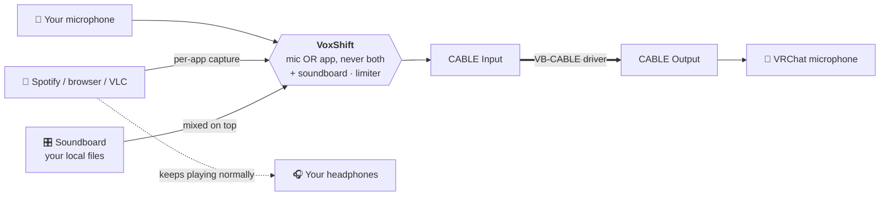
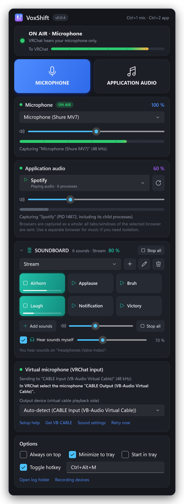
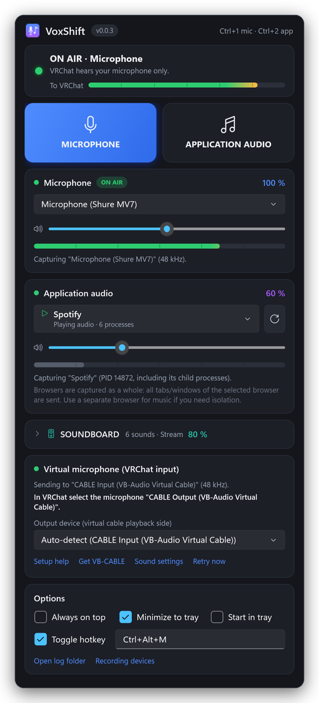

<p align="center">
  
</p>

<h1 align="center">VoxShift</h1>

<p align="center">
  <b>Talk, play music and fire off sound effects in VRChat with one click.</b><br>
  VoxShift sends <b>your microphone</b> or <b>the audio of one application</b> (Spotify, YouTube in your browser, VLC, …)
  into VRChat, and mixes in sounds from its <b>local soundboard</b>. Separate volumes, live meters, and no VRChat
  settings to touch.
</p>

<p align="center">
  <a href="https://github.com/crapclap161/voxshift/releases/latest"></a>
  <a href="https://github.com/crapclap161/voxshift/actions/workflows/ci.yml"></a>
  
  <a href="LICENSE"></a>
</p>

<p align="center">
  <a href="#-quick-start"><b>Quick start</b></a> ·
  <a href="#-features"><b>Features</b></a> ·
  <a href="#soundboard"><b>Soundboard</b></a> ·
  <a href="#how-it-works"><b>How it works</b></a> ·
  <a href="#-troubleshooting"><b>Troubleshooting</b></a> ·
  <a href="#-development"><b>Development</b></a>
</p>

<p align="center">
  
</p>

<p align="center"><sub>Left: <b>Application audio</b> mode, where VRChat hears only Spotify. Right: <b>Microphone</b> mode with
the <b>soundboard</b> open and two sounds playing. Rendered from the real UI with sample devices and sounds.</sub></p>

---

## ✨ Why VoxShift?

- 🎚️ **One click, no fiddling.** Point VRChat's microphone at the virtual cable once. Every switch after that happens in
  VoxShift, instantly and without restarting VRChat.
- 🔒 **Never both at once.** In application mode not a single sample of your microphone is sent, and in microphone
  mode no music leaks through. A switch fades one source out completely before the other fades in.
- 🎧 **You still hear your music.** The selected app keeps playing in your headphones. VRChat gets a copy at the volume
  *you* choose.
- 🎯 **Only that app.** VoxShift captures just the selected program, not your whole desktop, so Discord pings and game
  sounds stay private.
- 🎛️ **A soundboard built in.** Drag sounds from Explorer into VoxShift and play them into VRChat on top of your voice
  or your music. Your files stay exactly where they are.

## 🚀 Quick start

| | Step |
|:-:|---|
| **1** | Install the free **[VB-CABLE](https://vb-audio.com/Cable/)** driver (`VBCABLE_Setup_x64.exe` → *Run as administrator* → *Install Driver*) and **reboot**. |
| **2** | Download **`VoxShift-v…-win-x64-portable.exe`** from the **[latest release](https://github.com/crapclap161/voxshift/releases/latest)** and run it. It's portable: no installer, no .NET, nothing to extract. (A ZIP with docs is available too.) |
| **3** | Choose your **microphone** and the **application** to share (start it first, then press ⟳ or F5), and set both volumes. |
| **4** | In VRChat: **Settings → Audio & Voice → Microphone → `CABLE Output (VB-Audio Virtual Cable)`**. You only do this once. |
| **5** | Press **🎤 MICROPHONE** (Ctrl+1) to talk and **🎵 APPLICATION AUDIO** (Ctrl+2) to play music. |
| **6** | Optional: drag audio files onto the **SOUNDBOARD** and click a button to play it into VRChat. |

> [!TIP]
> Turn **off VRChat's Noise Suppression** while playing music, because it treats music as noise.
> If **LIMIT** lights up next to the *To VRChat* meter, lower the application volume a little.

> [!NOTE]
> `VoxShift.exe` isn't code-signed yet, so SmartScreen may show *“Windows protected your PC”*. Choose
> **More info → Run anyway**, and verify the download against `SHA256SUMS.txt` from the release.

## 🧩 Features

<table>
<tr>
<td width="50%" valign="top">

**Switching**
- Two large mode buttons with an animated highlight
- Click-free switching where the sources are never mixed (8 ms fade-out, then fade-in)
- **ON AIR** indicator that shows exactly what VRChat hears, also announced to screen readers
- Global toggle hotkey (default `Ctrl+Alt+M`, configurable)
- Ctrl+1, Ctrl+2 and F5 shortcuts in the window, and mode switching from the tray menu

**Audio**
- Separate microphone and application volume, **0–200 %**
- −1 dBFS peak limiter, so 200 % never clips harshly
- Live meters for microphone, application and the final output
- Clock-drift compensation for long sessions
- About 40–70 ms end-to-end latency

</td>
<td width="50%" valign="top">

**Soundboard**
- Local soundboard, played through the virtual microphone into VRChat
- Drag & drop audio imports straight from Windows Explorer
- Multiple soundboard collections that are created automatically on the first drop
- Collapsible soundbar, sounds that play simultaneously, and Stop all
- Independent soundboard volume (0–200 %)
- Hear the sounds yourself in your headphones, with its own volume
- Plays your original files in place, never copied

**Application capture**
- Lists running apps, with the ones currently playing marked ▷
- Groups multi-process apps (Chrome, Edge, Firefox, Spotify, Discord) into one entry
- Re-attaches automatically when the app restarts


**Comfort and reliability**
- Recovers automatically when devices are unplugged or Windows defaults change
- Always on top, minimize to tray, start in tray
- Remembers all settings, and imports them from *VRChat Audio Switcher*
- Built-in setup guide and clear errors and warnings
- 100 % local: no network access, no telemetry, no admin rights

</td>
</tr>
</table>

<a id="how-it-works"></a>
## ⚙️ How it works

VRChat can only record from a Windows **recording device**, and a normal application can't create one. The free
VB-CABLE driver is the bridge, and VoxShift decides what goes into it:



Your physical microphone is never muted in Windows, so Discord and other apps keep working.

<a id="soundboard"></a>
## 🎛️ Soundboard

The soundboard plays **sound files from your PC into VRChat** with one click: air horns, applause, stream alerts, short
jingles. Sounds go through the same virtual microphone as your voice, so other players hear them in VRChat. You
don't need to change anything in VRChat.

<p align="center"></p>
<p align="center"><sub>The expanded soundboard: collection selector, sound buttons (two playing, with progress bars), Add sounds,
soundboard volume and Stop all.</sub></p>

### Open and collapse the soundbar

The **SOUNDBOARD** section sits below the application card. Click its header (the ▾ / ▸ arrow) to collapse or expand it.
When collapsed, only one compact line remains: the number of sounds, the active collection and the volume. VoxShift
remembers the state for the next start. While sounds are playing, a **Stop all** button also appears in the
collapsed header.

<p align="center"></p>
<p align="center"><sub>Collapsed soundbar: the microphone and application controls keep all the space.</sub></p>

### Add sounds with drag & drop

1. Open Windows Explorer next to VoxShift.
2. Select one or more audio files, or a whole folder.
3. Drag them onto the **SOUNDBOARD** section. It lights up as a drop target, even when it is collapsed.
4. Drop them. A button appears for each new sound right away, and the soundbar expands.

<p align="center"></p>
<p align="center"><sub>The drop target while files are dragged over the soundbar.</sub></p>

- **Your first soundboard is created automatically.** If you have none yet, dropping files creates one called
  *Soundboard*. Otherwise the files go into the selected collection.
- Prefer a dialog? Click **Add sounds** and pick files with the Windows file picker.
- **Supported formats:** WAV, MP3, FLAC, M4A/AAC and WMA. Unsupported files (e.g. `.ogg`), missing files and files
  that are already on the soundboard are skipped, and VoxShift tells you which ones and why.

### Your files stay where they are

> [!IMPORTANT]
> VoxShift **does not copy, move, upload, or modify** imported audio files. The soundboard references and plays the
> original files directly from their local locations, for example `D:\Music\Soundboard\airhorn.mp3`.
> Removing a soundboard entry, or deleting a whole collection, **never deletes the original audio file**.

If you move or rename a file later, its button shows a ⚠ warning instead of failing. Right-click it, choose
**Relink file…**, and point it at the new location.

### Play, stop and adjust volume

| Action | How |
|---|---|
| Play a sound | Click its button. Several sounds can play at the same time, and a playing button lights up with a progress bar. |
| Stop one sound | Click the playing button again, or right-click → **Stop** |
| Play the same sound overlapping | Right-click → **Play (overlap)** |
| Stop everything | **Stop all** (in the footer, and in the header while sounds play) |
| Soundboard volume | The soundboard slider (0–200 %) sets how loud VRChat hears the sounds. It is independent of the microphone and application volume, and the header shows the value. |
| Hear sounds yourself | **Hear sounds myself** (on by default) also plays every sound in your headphones, with its own volume slider. It doesn't change what VRChat hears. |
| Rename, relink, remove | Right-click a button → **Rename…**, **Relink file…**, **Show in Explorer**, **Remove from soundboard** |

### Multiple soundboards

Use the collection selector to switch between soundboards, for example *Stream* and *Memes*. The buttons next to it
create **＋** a new soundboard, **✎** rename the current one, or **🗑** delete it (only the buttons are removed, never
your files).

### How it is mixed

| VoxShift mode | VRChat hears |
|---|---|
| 🎤 Microphone | your microphone **+** soundboard |
| 🎵 Application audio | the selected application **+** soundboard |

The soundboard is an extra layer on top of the active source. The basic rule still applies: **microphone and
application audio are never sent together**, and switching modes doesn't interrupt sounds that are playing. Soundboard
audio goes through VoxShift's limiter and shows up in the *To VRChat* meter.

### Hear the sounds yourself

With **Hear sounds myself** enabled, every sound you play also comes out of your **Windows default playback device**
(your headphones), so you hear exactly what you just sent to VRChat:

| Sound goes to | Volume control | Contains |
|---|---|---|
| VRChat (virtual microphone) | Soundboard volume slider | microphone **or** application **+** soundboard |
| Your headphones | *Hear sounds myself* slider | soundboard only |

- Only the soundboard is played back to you. Your own microphone is never echoed into your headphones, and the
  captured application plays there as usual anyway.
- VoxShift follows your Windows default playback device. If you switch from speakers to headphones, monitoring
  switches with you.
- For safety, VoxShift never monitors into the virtual cable. If your Windows default playback device *is* CABLE Input,
  monitoring pauses and VoxShift shows a hint, because otherwise VRChat would hear every sound twice. Set your
  headphones as the default playback device.
- If the virtual microphone isn't running (e.g. VB-CABLE not installed yet), sounds still play in your headphones and
  VoxShift tells you that VRChat can't hear them.

### Saved automatically

Collections, buttons, names, file paths, the soundboard volume, the selected collection and the collapsed or expanded
state are saved to `%APPDATA%\VoxShift\settings.json` right away. They are there again after a restart. No audio
data is stored, only the paths to your files.

> [!NOTE]
> Each sound is decoded once and kept in memory, up to 5 minutes per sound. Use application mode for long music.

## 💻 Supported platforms and requirements

| | |
|---|---|
| Operating system | **Windows 11 x64**. Application capture also works on Windows 10 build 20348 or newer. On older builds microphone mode still works. |
| Virtual audio driver | [VB-CABLE](https://vb-audio.com/Cable/) (free/donationware, installed separately). VB-Audio's CABLE-A to CABLE-D and other virtual cables can be selected manually. |
| Runtime | None. The release is a self-contained single-file executable. |
| Permissions | Standard user. Administrator rights are only needed once, to install the VB-CABLE driver. |

<details>
<summary><b>📖 Detailed setup guide</b></summary>

### 1. Install VB-CABLE

1. Download **VBCABLE_Driver_Pack** from <https://vb-audio.com/Cable/>.
2. Extract it, right-click **`VBCABLE_Setup_x64.exe` → Run as administrator → Install Driver**, and **reboot**.
3. In *Settings → System → Sound*, make sure the defaults are still your real devices. The installer sometimes changes them:
   - **Output:** your headphones or speakers, *not* “CABLE Input”
   - **Input:** your real microphone, *not* “CABLE Output”

| Device | Type | Used by |
|---|---|---|
| `CABLE Input (VB-Audio Virtual Cable)` | Playback | VoxShift writes into it (auto-detected) |
| `CABLE Output (VB-Audio Virtual Cable)` | Recording | VRChat records from it |

### 2. Configure VRChat (once)

1. **Launch Pad → Settings → Audio & Voice → Microphone:** `CABLE Output (VB-Audio Virtual Cable)`
2. For music: turn **Noise Suppression off**, and prefer toggle talk or an open mic over push-to-talk.
3. Leave VRChat's microphone volume at 100 % and use VoxShift's sliders instead.

<p align="center"></p>

</details>

## 🕹️ Usage

| Action | How |
|---|---|
| Talk | **🎤 MICROPHONE**, `Ctrl+1`, the tray menu, or the global hotkey |
| Play an app into VRChat | Select the app, then **🎵 APPLICATION AUDIO**, `Ctrl+2`, the tray menu, or the global hotkey |
| Add a sound effect | Drag an MP3 or WAV from Explorer onto the **SOUNDBOARD**, or use **Add sounds** |
| Play it into VRChat | Click its button on the soundboard (mixed with your microphone or application audio) |
| Make sounds louder or quieter | Move the soundboard volume slider (0–200 %) |
| Stop all sounds | **Stop all** |
| Save space | Click the **SOUNDBOARD** header to collapse the soundbar |
| Refresh the app list | ⟳ or `F5` |
| Run in the background | Enable *Minimize to tray* (and optionally *Start in tray*) |
| Start hidden from a script or shortcut | `VoxShift.exe --minimized` |

Settings are stored in `%APPDATA%\VoxShift\settings.json` and logs in `%LOCALAPPDATA%\VoxShift\logs`
(open them with *Open log folder*). To uninstall, delete the program folder and those two directories.

## ⚠️ Limitations

> [!IMPORTANT]
> **Capture works per application, not per browser tab.** Windows captures audio per process tree, and browsers
> play every tab through one audio process. Selecting Chrome sends *all* Chrome tabs. Play music in a second browser
> or use a desktop app such as Spotify or VLC.

- **DRM-protected playback** (some streaming sites) may be captured as silence.
- **A virtual audio driver is required.** Windows has no driver-free way for an app to create a microphone.
- **Exclusive-mode microphones** can't be captured while another program holds them exclusively.
- **Elevated games:** if a focused program runs as administrator, Windows may not deliver the global hotkey to VoxShift.
- **Soundboard:** OGG/Opus files aren't supported by Windows' built-in decoders, and sounds longer than 5 minutes are
  cut. Monitoring always uses the Windows default playback device; picking a different monitor device isn't
  supported yet.

## 🛠 Troubleshooting

<details>
<summary><b>Show common problems and fixes</b></summary>

| Symptom | Fix |
|---|---|
| *“No virtual audio cable found”* | Install VB-CABLE and reboot, then press **Retry now**. |
| Nobody hears anything | VRChat's microphone must be **CABLE Output**, and VoxShift must show **ON AIR**. Check that you aren't muted in VRChat. |
| I can't hear anything on my PC anymore | Your Windows default output is CABLE Input. Set your headphones as default (VoxShift warns about this). |
| Others hear the music twice or with an echo | The music app outputs directly to *CABLE Input* (*Settings → Sound → Volume mixer*). Reset it to your headphones, and disable *“Listen to this device”* on CABLE Output. |
| The app shows *“is not running”* | Start the program and press ⟳. It's also picked up automatically once it starts. |
| The application meter stays empty | The app isn't playing, plays DRM-protected content, or the sound comes from another process (e.g. the game instead of its launcher). |
| *“Access denied”* when capturing an app | The target runs as administrator. Run both programs with the same privileges. |
| Microphone error mentions *exclusive mode* | Microphone → Properties → Advanced → untick *Allow applications to take exclusive control*. |
| Microphone access denied | *Settings → Privacy & security → Microphone* → allow **desktop apps**. |
| Music sounds choppy in VRChat | Turn off VRChat's Noise Suppression. Lower the volume if **LIMIT** is lit. |
| The hotkey doesn't register | Another program uses it. Click the hotkey box and press a different combination. |
| A soundboard button shows ⚠ | The file was moved, renamed or deleted. Right-click → **Relink file…** |
| I don't hear soundboard sounds myself | Enable **Hear sounds myself** and raise its slider. Make sure your headphones are the Windows default playback device (not CABLE Input). The hint below the slider shows which device is used. |
| *“Unsupported format”* when dropping | Convert the file to WAV, MP3, FLAC, M4A/AAC or WMA (OGG/Opus isn't supported). |
| Clicking a sound does nothing in VRChat | The virtual microphone must be running (green *Virtual microphone* card), and VRChat must use CABLE Output. Check the soundboard volume. |
| Anything else | Use **Open log folder** and check `VoxShift.log`, then [open an issue](https://github.com/crapclap161/voxshift/issues). |

</details>

## 🔒 Privacy

Audio is processed in memory and only sent to the local virtual cable. VoxShift makes no network connections and has no
telemetry. Links in the app (VB-CABLE website, Windows sound settings) only open when you click them.

## 🧑‍💻 Development

Requires the **.NET 10 SDK** (see `global.json`). Building works on Windows, Linux and macOS
(`EnableWindowsTargeting`). Running requires Windows.

```bash
dotnet restore VoxShift.sln
```

```bash
dotnet build VoxShift.sln -c Release
```

```bash
dotnet test tests/VoxShift.Core.Tests
```

```bash
dotnet format VoxShift.sln --verify-no-changes
```

```bash
dotnet publish src/VoxShift/VoxShift.csproj -c Release -r win-x64 -o publish
```

`publish/VoxShift.exe` is the self-contained single-file build (about 75 MB, including the .NET and WPF runtimes).

<details>
<summary><b>Project structure</b></summary>

```
VoxShift.sln
Directory.Build.props          version (single source of truth), shared build settings
src/
  VoxShift.Core/               platform-independent and unit tested: router, soundboard mixer and library,
                               WAV decoder, resampler, limiter, settings, logging, process grouping, hotkeys
  VoxShift.Audio/              Windows audio: WASAPI capture/render (NAudio), process-loopback COM
                               interop, device monitoring, self-healing AudioEngine, soundboard
                               player (Media Foundation decoding, clip cache)
  VoxShift/                    WPF app (Fluent dark theme): view model, views, tray, global hotkey
tests/VoxShift.Core.Tests/     xUnit tests (routing isolation, switching, soundboard mixing and library,
                               gain, limiter, resampling, drift, settings, migration, …)
scripts/                       package.ps1 (portable EXE, ZIP, checksums), smoke-test.ps1
.github/workflows/             ci.yml, release.yml, screenshots.yml
docs/                          screenshots, release notes, image tooling
```

Command-line switches: `--minimized`, `--smoke-test <report>` (used by CI), and `--render-screenshots <dir>`
(used by the screenshots workflow).

</details>

See [CONTRIBUTING.md](CONTRIBUTING.md) for the workflow and quality checks.

## 📦 Releases

VoxShift uses [Semantic Versioning](https://semver.org). The version lives in `Directory.Build.props`
(`<VersionPrefix>`). Pushing a matching tag `vX.Y.Z` runs `.github/workflows/release.yml`, which validates,
builds, tests, smoke-tests and packages the app, then publishes a GitHub Release with the portable
`VoxShift-vX.Y.Z-win-x64-portable.exe`, `VoxShift-vX.Y.Z-win-x64.zip` and `SHA256SUMS.txt`. See [CHANGELOG.md](CHANGELOG.md) for the history.

## 📄 License

[MIT](LICENSE) © 2026 crapclap161. Third-party components are listed in [THIRD-PARTY-NOTICES.md](THIRD-PARTY-NOTICES.md).

<p align="center"><sub>
VoxShift is an independent project. It is not affiliated with or endorsed by VRChat Inc. or VB-Audio Software.
</sub></p>
