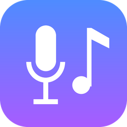
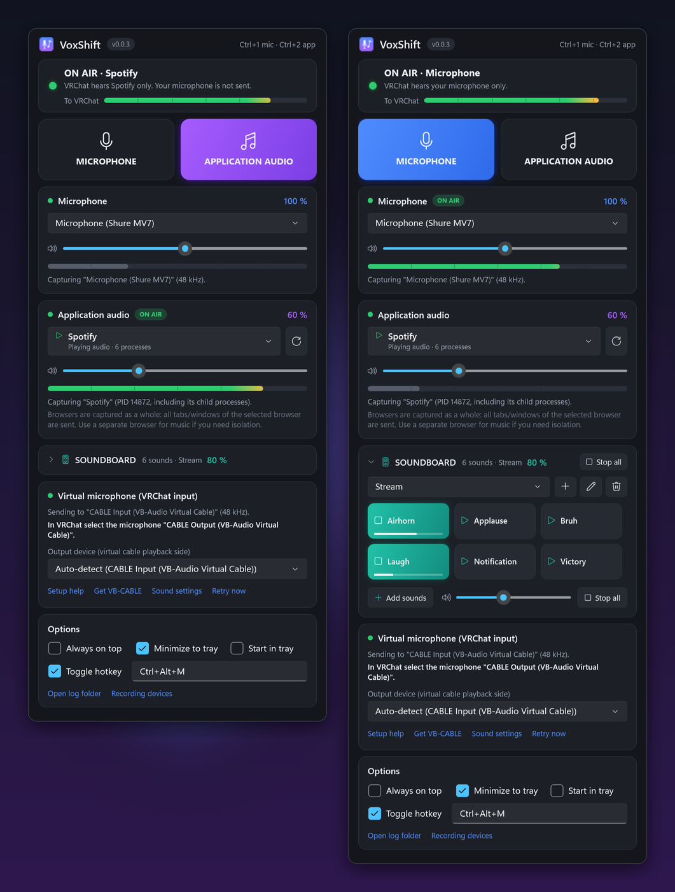
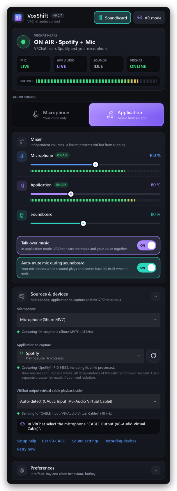
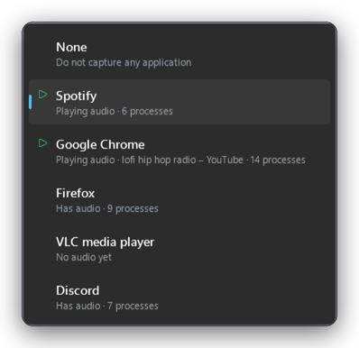
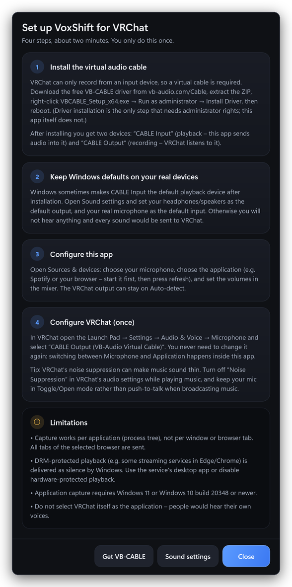
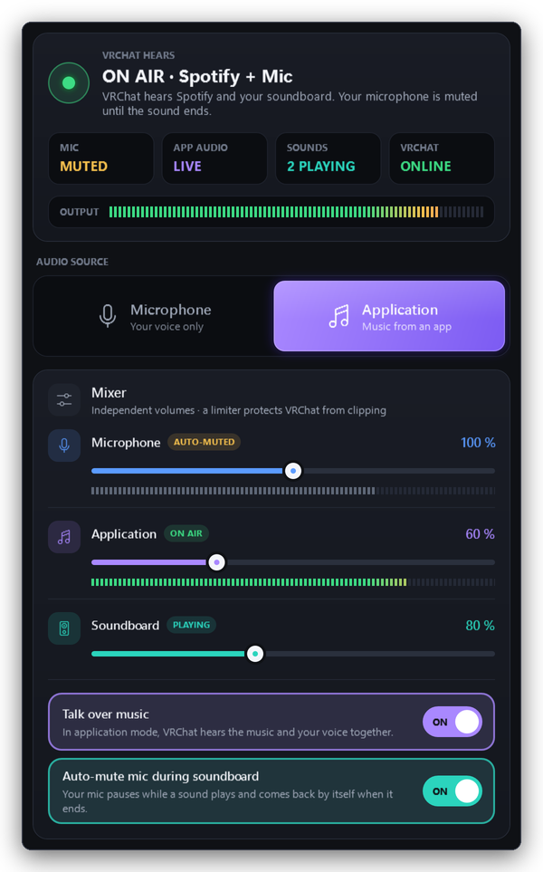
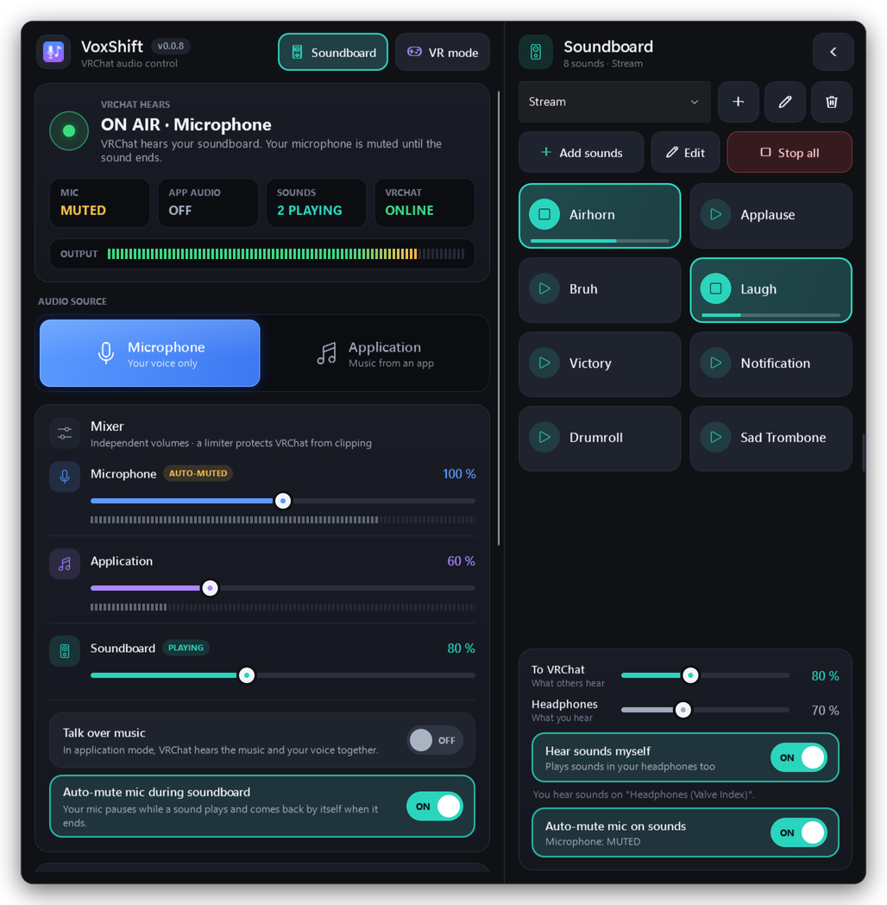
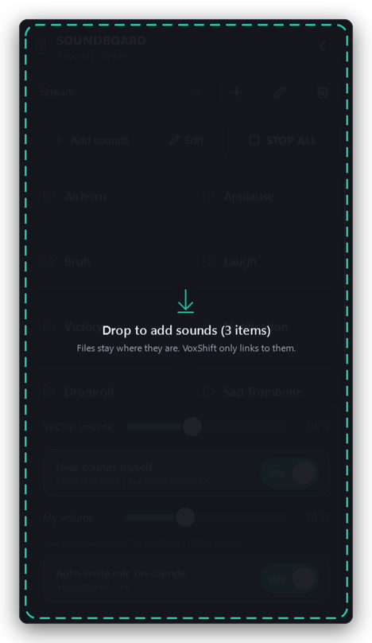
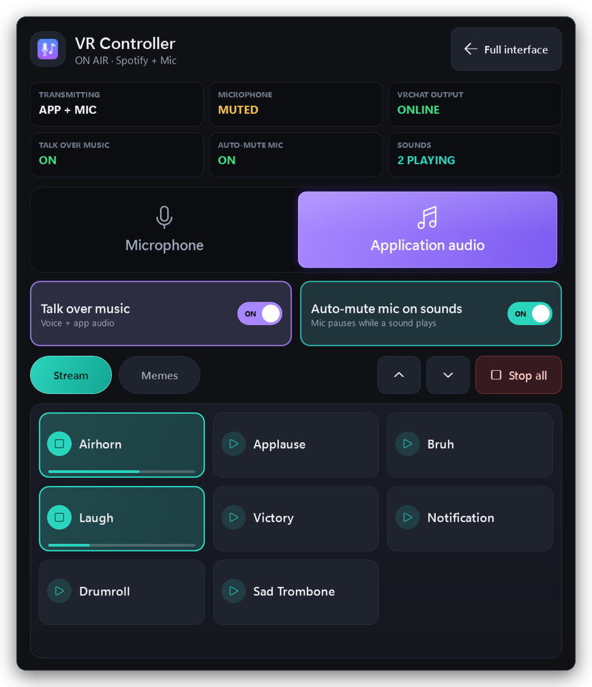
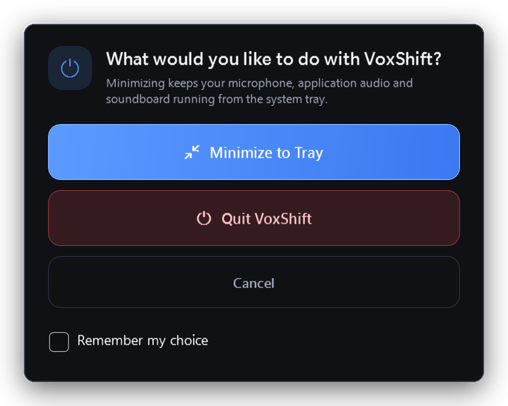

<p align="center">
  
</p>

<h1 align="center">VoxShift</h1>

<p align="center">
  <b>Play music and sound effects into VRChat, and switch between your voice and your music with one click.</b><br>
  A free audio switcher and soundboard for VRChat on Windows, made to be easy to use with VR controllers.
</p>

<p align="center">
  <a href="https://github.com/crapclap161/voxshift/releases/latest"></a>
  <a href="https://github.com/crapclap161/voxshift/actions/workflows/ci.yml"></a>
  
  <a href="LICENSE"></a>
</p>

<p align="center">
  
</p>

<p align="center"><sub>The main window with the soundboard docked on its right. Two sounds are playing, so VoxShift has
muted the microphone automatically; it comes back by itself when they end. (Screenshot of the real app with sample data.)</sub></p>

## ⬇️ Download

<table>
<tr>
<td align="center" width="50%">

### **[⬇ Download VoxShift](https://github.com/crapclap161/voxshift/releases/latest)**

Open the page, scroll to **Assets** and click<br>
**`VoxShift-v…-win-x64-portable.exe`**<br>
It is one file. No installer, nothing to extract.

</td>
<td valign="top" width="50%">

- **Needs:** Windows 11 (64-bit) and the free [VB-CABLE](https://vb-audio.com/Cable/) driver (see [step 1](#step-1--install-vb-cable))
- **Also available:** a `.zip` with the same program plus the documentation
- **Cost:** free and open source ([MIT license](LICENSE))
- **Private:** works offline, no account, no tracking

</td>
</tr>
</table>

> [!NOTE]
> **About Windows security warnings.** From **v0.0.8**, `VoxShift.exe` is signed with a **self-signed** certificate that
> belongs to the VoxShift project. That lets you confirm the file is unmodified and comes from the VoxShift release key,
> but Windows does **not** trust a self-signed certificate on its own and does **not** treat it as a verified publisher.
> So *“Windows protected your PC”* (SmartScreen) **can still appear**. That is expected: see
> [Windows warns me when I start VoxShift](#windows-warns-me-when-i-start-voxshift). Versions up to v0.0.7 are not signed.
> Every release also contains `SHA256SUMS.txt` so you can [check your download](#check-your-download-optional).

## 🤔 What is VoxShift?

VRChat only listens to **one microphone**. That makes it awkward to play music for your friends, because VRChat can't
hear your music, only what your microphone picks up.

VoxShift solves this. It creates a "virtual microphone" for VRChat and lets you decide, with one click, what goes into it:

- 🎤 **Your voice** (normal talking)
- 🎵 **Music from one app**, such as Spotify, VLC or a web browser
- 🎤🎵 **Both at once**, so you can talk over your music
- 🎛️ **Sound effects** from a built-in soundboard (air horn, applause, jingles, …)

**Who is it for?** VRChat users who DJ, perform, host events, stream, or just like to play music and sounds for
their friends, with a desktop or VR headset.

## ✨ What you can do

- **Switch with one click.** Choose *Microphone* or *Application* and VRChat hears the change instantly. No restart.
- **Talk over music.** Turn on *Talk over music* and VRChat hears your voice and the music together, with separate volumes.
- **Soundboard.** Drag audio files onto the soundboard and click a button to play them into VRChat. Your own files
  are used where they are; nothing is copied.
- **Automatic microphone muting.** While a sound plays, VoxShift mutes your microphone *for VRChat only*, and brings it
  back when the sound ends. No more voice over the air horn.
- **VR Controller Mode.** One simple window with big buttons you can hit with a VR controller.
- **Safe volume.** A built-in limiter stops loud mixes from distorting.
- **Runs quietly.** It can live in the system tray, and a global hotkey toggles between voice and music.

<p align="center"></p>
<p align="center"><sub><b>The main window.</b> At the top you see what VRChat hears right now. Below it are the
<b>Microphone / Application</b> switch and the mixer with one volume slider per source.</sub></p>

## 🚀 Setup guide (about 10 minutes)

You only have to do this once. You will need: Windows 11, VRChat, a microphone, and an internet connection for the
downloads.

### Step 1 · Install VB-CABLE

VRChat can only listen to a *recording device*, and Windows programs can't create one on their own. **VB-CABLE** is a
small, free driver by VB-Audio that adds a virtual cable: VoxShift sends audio into one end, VRChat listens at the other.

1. Open <https://vb-audio.com/Cable/> and download **VBCABLE_Driver_Pack**.
2. Open the downloaded `.zip` and **extract** it to a folder (right-click → *Extract All…*).
3. In that folder, right-click **`VBCABLE_Setup_x64.exe`** → **Run as administrator**.
4. Click **Install Driver**, then accept the Windows prompt.
5. **Restart your computer.** The driver doesn't work until you do.
6. After the restart, open *Settings → System → Sound* and check that your real devices are still selected:
   **Output** = your headphones or speakers (*not* “CABLE Input”) and **Input** = your real microphone (*not* “CABLE Output”).
   The installer sometimes changes these.

You now have two new devices: **CABLE Input** (a playback device, where VoxShift sends audio) and **CABLE Output**
(a recording device, which VRChat will listen to).

> [!TIP]
> VoxShift also works with VB-Audio's other virtual cables (CABLE-A to CABLE-D). The free single **VB-CABLE** is all you need.

### Step 2 · Download and start VoxShift

1. Open the **[latest release](https://github.com/crapclap161/voxshift/releases/latest)** and download
   **`VoxShift-v…-win-x64-portable.exe`** from **Assets**.
2. Move it to a folder you like, for example `C:\Tools\VoxShift\` or your Desktop.
3. **Double-click** it. There is no installer. If Windows shows a blue *“Windows protected your PC”* window, see
   [Windows warns me when I start VoxShift](#windows-warns-me-when-i-start-voxshift).

Prefer the **ZIP**? Right-click it → *Extract All…*, then start `VoxShift.exe` from the extracted folder. Don't run it
from inside the zip.

### Step 3 · Choose your devices in VoxShift

In the **Sources & devices** section of the main window (open by default):

| Setting | What to choose |
|---|---|
| **Microphone** | Your real microphone. VoxShift shows *Capturing “…”* when it works. |
| **Application to capture** | The program whose sound you want to share, for example **Spotify**. Start the program first, then press the **⟳** button (or **F5**) to refresh the list. Programs that are playing sound are marked with ▷. |
| **VRChat output (virtual cable)** | Leave it on **Auto-detect**. It should show *Sending to “CABLE Input (VB-Audio Virtual Cable)”*. |

<p align="center"></p>

If you see a message that no virtual cable was found, VB-CABLE isn't installed yet or you haven't restarted. Click
**Setup help** for the built-in guide, install VB-CABLE, restart, then click **Retry now**.

<p align="center"></p>

### Step 4 · Tell VRChat to listen to the virtual cable

1. Start VRChat.
2. Open the **Launch Pad** → **Settings** → **Audio & Voice**.
3. Set **Microphone** to **`CABLE Output (VB-Audio Virtual Cable)`**.
4. Turn **Noise Suppression off**. It treats music as noise and makes it sound choppy.
5. Leave VRChat's microphone volume at 100 % and use VoxShift's sliders instead.

> [!IMPORTANT]
> Because VRChat now listens to the virtual cable, **only what VoxShift sends** is heard by other players. In
> *Microphone* mode that is your voice, so you talk as normal.

### Step 5 · Test it

1. In VoxShift, click **Microphone**. The top card should say **ON AIR · Microphone**. Speak: the **Output** meter moves.
2. Ask a friend (or use a private instance) to confirm they hear you.
3. Start music in Spotify, select Spotify in VoxShift and click **Application**. Your friend now hears the music.

That's it. 🎉

## 🕹️ Using VoxShift

### Voice and music

| I want to… | Do this |
|---|---|
| Talk normally | Click **Microphone** (or press `Ctrl+1`) |
| Play music for everyone | Select the app, click **Application** (or `Ctrl+2`) |
| Talk while the music plays | Click **Application**, then turn on **Talk over music** (or `Ctrl+T`) |
| Go back to voice only | Click **Microphone** |
| Switch from anywhere, even inside VRChat | Press the global hotkey, default **`Ctrl+Alt+M`** (it toggles between Microphone and Application; change it in *Preferences*) |
| Change the volumes | Use the sliders in the **Mixer** card (0–200 % each). Lower the music a little so your voice stays clear. |

The `Ctrl+…` shortcuts work while a VoxShift window is focused. Use the **Mixer** meters to check levels: if **LIMIT**
lights up next to the *Output* meter, lower a volume slightly.

**What does VRChat hear?** The top card always tells you, in plain words, for example *“ON AIR · Spotify. VRChat hears
Spotify and your microphone.”* The four tiles show the current state of the microphone, the app, the soundboard and the
VRChat connection.

<p align="center"></p>
<p align="center"><sub>Talk over music is on and a sound is playing: the music continues, and the microphone tile shows <b>MUTED</b>.</sub></p>

> [!NOTE]
> **VRChat can't tell browser tabs apart.** Windows shares audio per program, not per tab. Choosing Chrome shares *all*
> Chrome tabs. For music, use a desktop app like Spotify or VLC, or a second browser.

### Soundboard

The soundboard is attached to the right side of the main window. Show or hide it with the **Soundboard** button at the
top (or `Ctrl+B`).

<p align="center"></p>

**Add sounds**

1. Open the folder with your sound files in Windows Explorer.
2. Drag one or more files (or a whole folder) onto the soundboard. It lights up when it's ready to receive them.
3. Release. A button appears for each sound. If you had no soundboard yet, VoxShift creates one for you.

You can also click **Add sounds** and choose files. Supported formats: **WAV, MP3, FLAC, M4A/AAC and WMA**. (OGG is not supported.)

<p align="center"></p>

**Play and manage sounds**

| I want to… | Do this |
|---|---|
| Play a sound | Click its button. Several sounds can play together. |
| Stop one sound | Click the playing button again |
| Stop all sounds | Click **Stop all** |
| Rename, relink or remove a sound | Click **Edit**, then click the sound (or right-click it) |
| Keep sounds in groups | Use the collection selector at the top: **＋** new, **✎** rename, **🗑** delete |
| Hear the sounds myself | Keep **Hear sounds myself** on and set the **Headphones** volume |
| Change how loud others hear them | **To VRChat** slider |
| Make the panel small | Click **◀** in the soundboard header. Click **▶** to open it again. |

> [!IMPORTANT]
> VoxShift **never copies, moves, uploads or changes** your sound files. It plays them from where they are. Removing a
> sound or a whole collection **does not delete the file**. If you later move or rename a file, its button shows a ⚠:
> use **Edit** → click the sound → **Relink file…**

### Automatic microphone muting

With **Auto-mute mic during soundboard** on (the default), VoxShift mutes your microphone *in VRChat's audio only* while
any sound plays, then restores it as soon as the last sound is finished. So you can keep talking, press the air horn,
and nobody hears you talk over it.

- Windows itself and other programs (Discord, …) are **not** muted. Only what VoxShift sends to VRChat changes.
- **Stop all** and failed sounds also bring your voice back. It can't get stuck.
- You still hear your own sounds in your headphones.
- Turn it off in the **Mixer** card, in the soundboard panel (**Auto-mute mic on sounds**), in VR Controller Mode or from
  the tray menu, if you'd rather talk over your sounds.

### VR Controller Mode

Pointing at small buttons with a VR controller is hard. **VR mode** replaces the main window and the soundboard with
one simple window that has big buttons.

<p align="center"></p>

- Click **VR mode** in the header to turn it on. Click **Full interface** (or press `Esc`) to go back.
- It contains the essentials: **Microphone / Application**, **Talk over music**, **Auto-mute**, your sound buttons and **Stop all**.
- To use it in VR, show the VoxShift window in a **VR desktop overlay** (SteamVR's desktop view, OVR Toolkit, XSOverlay,
  Virtual Desktop, …) and click it with the controller trigger.
- Switching modes never interrupts the audio.

> [!NOTE]
> VR Controller Mode is a normal Windows window that works with the mouse pointer your overlay provides. VoxShift has
> no direct SteamVR or OpenXR integration.

### Window, tray and closing

- When you click the **X** button, VoxShift asks whether to **minimize to the tray** (keeps running and routing audio)
  or **quit**. Tick *Remember my choice* to stop being asked, or change it later under *Preferences → When clicking the X button*.
- To quit completely: **X → Quit VoxShift**, or tray icon → **Exit VoxShift**.
- Other options in **Preferences** (collapsed by default): always on top, start in the tray and the global hotkey.

<p align="center"></p>

### Examples

- **Chill music in a world.** Spotify selected → *Application*. Everyone hears the music; mic off. Turn on *Talk over music* to chat.
- **DJ set.** *Application* + *Talk over music*. Lower the microphone slider to ~70 % so your announcements sit above the mix.
- **Stream / event host.** Load a collection with an intro jingle, applause and an air horn. Click them as needed; your
  voice pauses automatically for each sound.
- **Quick switch.** Use the global hotkey to jump between talking and music without leaving VRChat.

## 🛠 Troubleshooting

<details open>
<summary><b>Common problems and fixes</b></summary>

| Problem | What to do |
|---|---|
| **“No virtual audio cable found”** | Install [VB-CABLE](https://vb-audio.com/Cable/), **restart Windows**, then click **Retry now** in VoxShift. |
| **Nobody hears anything** | In VRChat, the microphone must be **CABLE Output (VB-Audio Virtual Cable)**. In VoxShift the top card must say **ON AIR** and the *VRChat* tile **ONLINE**. Also check you aren't muted in VRChat. |
| **Others don't hear me in Application mode** | That's normal: Application mode sends only the music. Turn on **Talk over music**. |
| **My voice disappears when I play a sound** | That's **Auto-mute**. Your voice returns when the sound ends. Turn Auto-mute off to talk over sounds. |
| **I can't hear anything on my PC** | Your Windows default output was switched to *CABLE Input*. In *Settings → System → Sound* set your headphones or speakers as the output. |
| **Others hear the music twice or an echo** | The music app is set to play into *CABLE Input* directly. In *Settings → System → Sound → Volume mixer* set the app back to your headphones, and make sure “Listen to this device” is off for *CABLE Output*. |
| **The application isn't in the list / “is not running”** | Start the program, play something, then press **⟳** or **F5**. |
| **The app's meter stays empty** | The app isn't playing sound, plays copy-protected (DRM) content, or the sound comes from another process. |
| **“Access denied” when sharing an app** | That app runs as administrator. Run VoxShift and the app with the same rights. |
| **Music sounds choppy or robotic in VRChat** | Turn **Noise Suppression off** in VRChat. If **LIMIT** is lit, lower a volume. |
| **Microphone error or “exclusive mode”** | Windows *Sound settings* → your microphone → *Properties → Advanced* → untick *Allow applications to take exclusive control*. |
| **Microphone access denied** | *Settings → Privacy & security → Microphone* → allow **desktop apps** to use the microphone. |
| **The soundboard has disappeared** | Click **Soundboard** (or `Ctrl+B`). If it's a narrow strip, click its **▶** handle. |
| **A sound button shows ⚠** | The file was moved, renamed or deleted. **Edit** → click the sound → **Relink file…** |
| **“Unsupported format” when dropping a file** | Convert it to WAV, MP3, FLAC, M4A/AAC or WMA. |
| **I can't hear my own sounds** | Turn on **Hear sounds myself** and raise **Headphones**. Your headphones must be the Windows default output (not CABLE Input). |
| **VoxShift disappeared after clicking X** | It's in the system tray. Click the tray icon → **Show VoxShift**. |
| **Stuck in VR Controller Mode** | Click **Full interface**, press `Esc`, or use the tray icon → **Show full interface**. |
| **The hotkey does nothing** | Another program uses it. Click the hotkey box in *Preferences* and press a different combination. Programs running as administrator may block global hotkeys. |
| **Anything else** | Click **Open log folder** in *Preferences*, look at `VoxShift.log`, and [open an issue](https://github.com/crapclap161/voxshift/issues/new/choose). |

</details>

### Windows warns me when I start VoxShift

*“Windows protected your PC”* (SmartScreen) is shown for programs Windows hasn't seen often or can't attribute to a
publisher it trusts. It is **not** an error and doesn't mean the file is infected, but only continue if you downloaded
VoxShift from the [official releases page](https://github.com/crapclap161/voxshift/releases).

1. Click **More info**.
2. The *Publisher* shows *Unknown publisher*. That is expected: the v0.0.8 signature uses a self-signed certificate, and
   older versions are unsigned.
3. Click **Run anyway**.

If you extracted the ZIP, you can avoid the prompt for every file: right-click the `.zip` **before** extracting →
*Properties* → tick **Unblock** → *OK*.

**Code-signing status, in plain words**

| Question | v0.0.8 |
|---|---|
| Is `VoxShift.exe` digitally signed (Authenticode, SHA-256, timestamped)? | Yes, with a **self-signed** certificate whose thumbprint is shown in the release notes |
| Can I check that the file is unmodified and made with the VoxShift release key? | Yes, see below |
| Does Windows trust the certificate by itself / show a verified publisher? | **No** |
| Will SmartScreen warnings disappear? | **No**, they can still appear |

A publicly trusted certificate from a certification authority could change the last two rows; the project may
move to one later. Do **not** install the VoxShift certificate into your Windows trust store. How signing works and its
limits: [docs/code-signing.md](docs/code-signing.md).

### Check your download (optional)

Every release includes `SHA256SUMS.txt`. In PowerShell, in the folder with your download (use the file name of the
version you downloaded):

```powershell
Get-FileHash .\VoxShift-v0.0.8-win-x64-portable.exe -Algorithm SHA256
```

The hash must equal the one listed for that file name in `SHA256SUMS.txt`. To inspect the signature:

```powershell
$s = Get-AuthenticodeSignature .\VoxShift-v0.0.8-win-x64-portable.exe
$s.Status                          # see the note below
$s.SignerCertificate.Thumbprint    # must equal the thumbprint in the release notes
```

For a self-signed certificate `Status` is normally `NotTrusted` or `UnknownError` (Windows doesn't trust the
certificate). That is expected. `HashMismatch` or `NotSigned` is **not** OK: don't run the file.

## ❓ Good to know

- **Windows:** Windows 11 x64 is recommended. Sharing an application's sound also works on Windows 10 build 20348 or
  newer; on older builds only microphone mode works.
- **Admin rights** are only needed once, to install VB-CABLE. VoxShift itself runs as a normal user.
- **Settings** are stored in `%APPDATA%\VoxShift\settings.json` and logs in `%LOCALAPPDATA%\VoxShift\logs`. Updating is
  just replacing the EXE; your settings, soundboards and hotkeys are kept.
- **Uninstall:** delete the VoxShift file or folder and those two folders. VB-CABLE is removed separately, using the
  uninstaller from its download (`VBCABLE_Setup_x64.exe` → *Remove Driver*).
- **Limits:** capture is per application, not per browser tab. Copy-protected (DRM) audio may be silent. Sounds are
  cut at 5 minutes each (use Application mode for long music). Hearing your own sounds uses the Windows default output.
- **Command line:** `VoxShift.exe --minimized` starts it hidden in the tray.

## 🔒 Privacy

VoxShift works completely offline: no network connections, no account and no telemetry. Audio stays in memory and
goes only to your local virtual cable. Sound files are read from where they are. Links inside the app (VB-CABLE
website, Windows sound settings) only open when you click them.

## 🤝 Help, feedback and contributing

- 🐛 **Found a bug?** [Open a bug report](https://github.com/crapclap161/voxshift/issues/new/choose). It helps to say
  your Windows version, the VoxShift version and what you clicked, and to attach `VoxShift.log` (*Preferences → Open log folder*).
- 💡 **Idea?** [Suggest a feature](https://github.com/crapclap161/voxshift/issues/new/choose).
- 🔐 **Security problem?** Please report it privately, see [SECURITY.md](SECURITY.md).
- 🧑‍💻 **Want to help?** Read [CONTRIBUTING.md](CONTRIBUTING.md).
- 📦 **All versions:** [Releases](https://github.com/crapclap161/voxshift/releases) · [Changelog](CHANGELOG.md)

## 📄 License

[MIT](LICENSE) © 2026 crapclap161. Third-party components are listed in [THIRD-PARTY-NOTICES.md](THIRD-PARTY-NOTICES.md).

<p align="center"><sub>
VoxShift is an independent project. It is not affiliated with or endorsed by VRChat Inc. or VB-Audio Software.
</sub></p>

---

## 🧑‍💻 For developers

<details>
<summary><b>Build, test, project structure and releases</b></summary>

### How it works (short version)

VoxShift captures your microphone, optionally one application's audio (Windows *process loopback*) and plays soundboard
files, mixes the sources that should be heard, passes them through a −1 dBFS peak limiter, and writes the result to
*CABLE Input*; VRChat records from *CABLE Output*. A *mix policy* (mode, talk over music, auto-mute, whether sounds are
playing) opens and closes a transmit gate per source with short fades, and with Talk over music off, microphone and
application audio are never mixed.

### Build

Requires the **.NET 10 SDK** (see `global.json`). Building works on Windows, Linux and macOS
(`EnableWindowsTargeting`); running requires Windows.

```bash
dotnet restore VoxShift.sln
```

```bash
dotnet format VoxShift.sln --verify-no-changes --no-restore
```

```bash
dotnet build VoxShift.sln -c Release
```

```bash
dotnet test tests/VoxShift.Core.Tests -c Release
```

```bash
dotnet publish src/VoxShift/VoxShift.csproj -c Release -r win-x64 -o publish
```

`publish/VoxShift.exe` is the self-contained single-file build (about 75 MB, including the .NET and WPF runtimes).

### Project structure

```
Directory.Build.props          product version (single source of truth), shared build settings
src/VoxShift.Core/             platform-independent, unit tested: router, mix policy, soundboard mixer and library,
                               resampler, limiter, dock geometry, settings, logging, hotkeys
src/VoxShift.Audio/            Windows audio: WASAPI capture/render (NAudio), process-loopback interop, devices, engine
src/VoxShift/                  WPF app: design system (Themes/Theme.xaml), views, view models, tray, hotkey
tests/VoxShift.Core.Tests/     xUnit tests
scripts/                       package.ps1, smoke-test.ps1, signing: create-signing-certificate / sign-executable /
                               verify-signature / test-signing .ps1
.github/workflows/             ci.yml, release.yml, screenshots.yml
docs/                          screenshots, release notes, code-signing guide
```

Command-line switches: `--minimized`, `--smoke-test <report>` (CI) and `--render-screenshots <dir>` (the screenshots
workflow, which renders the real windows with sample data).

### Releases

The version lives in `Directory.Build.props` (`<VersionPrefix>`); every release needs a matching `CHANGELOG.md` entry and
`docs/release-notes/vX.Y.Z.md`. To release: run the **Screenshots** workflow on the release branch (it commits fresh
screenshots), then push the tag `vX.Y.Z` (or run **Release** manually with the tag). The release workflow builds, tests,
**signs** `VoxShift.exe` (Authenticode, self-signed certificate stored in GitHub secrets), verifies the signature,
smoke-tests the signed file, packages it, verifies the packaged files and checksums, and publishes `VoxShift-vX.Y.Z-win-x64-portable.exe`, `VoxShift-vX.Y.Z-win-x64.zip` and
`SHA256SUMS.txt`. Signing needs a one-time setup of two repository secrets, described in
[docs/code-signing.md](docs/code-signing.md); without them the release workflow stops before publishing.

</details>
