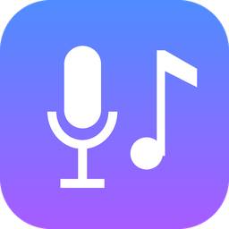
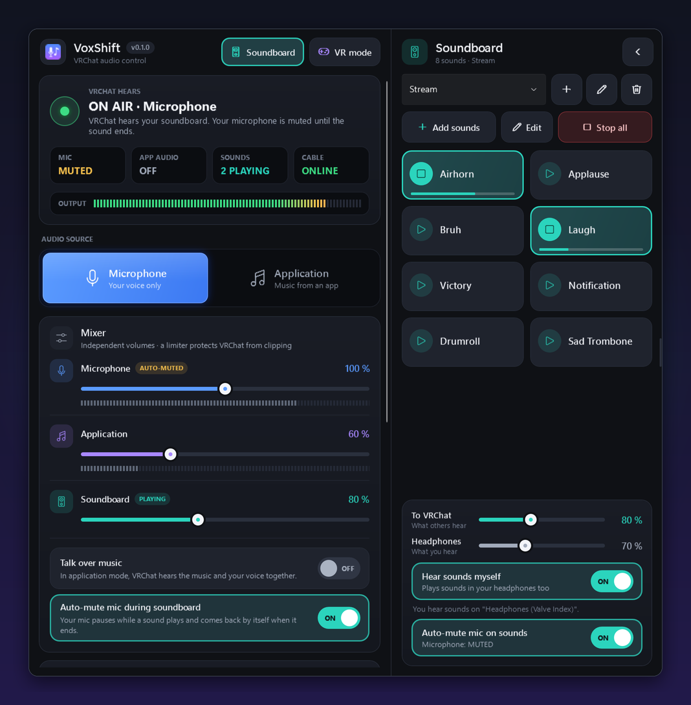
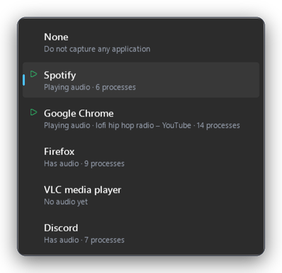
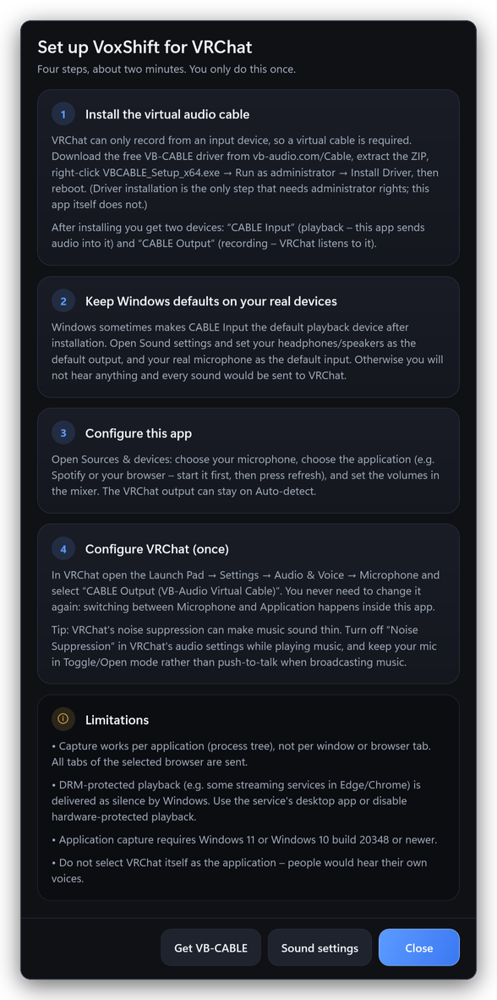
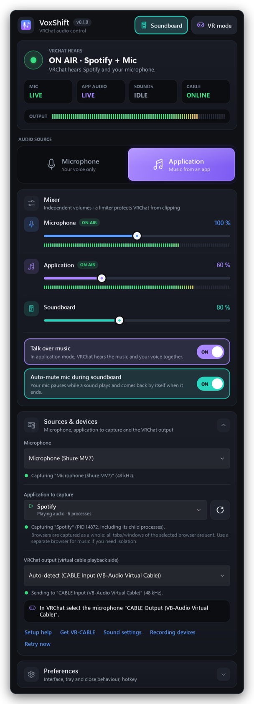
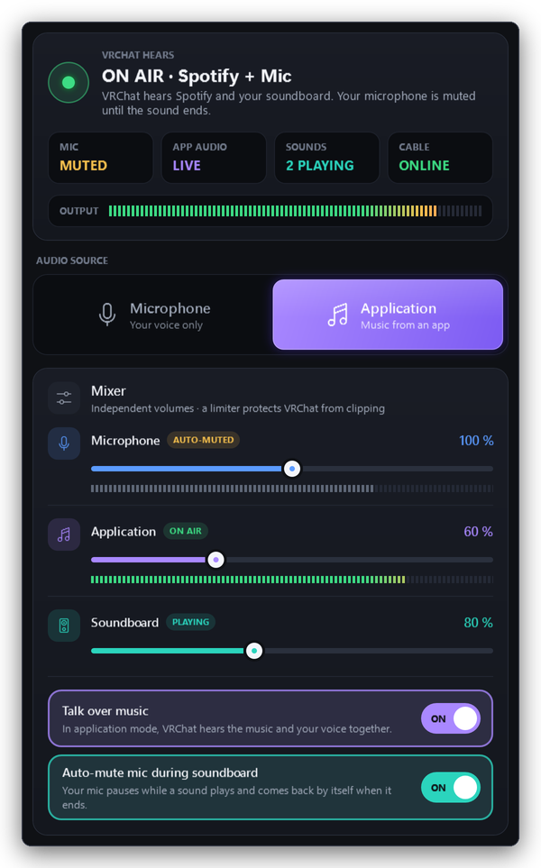
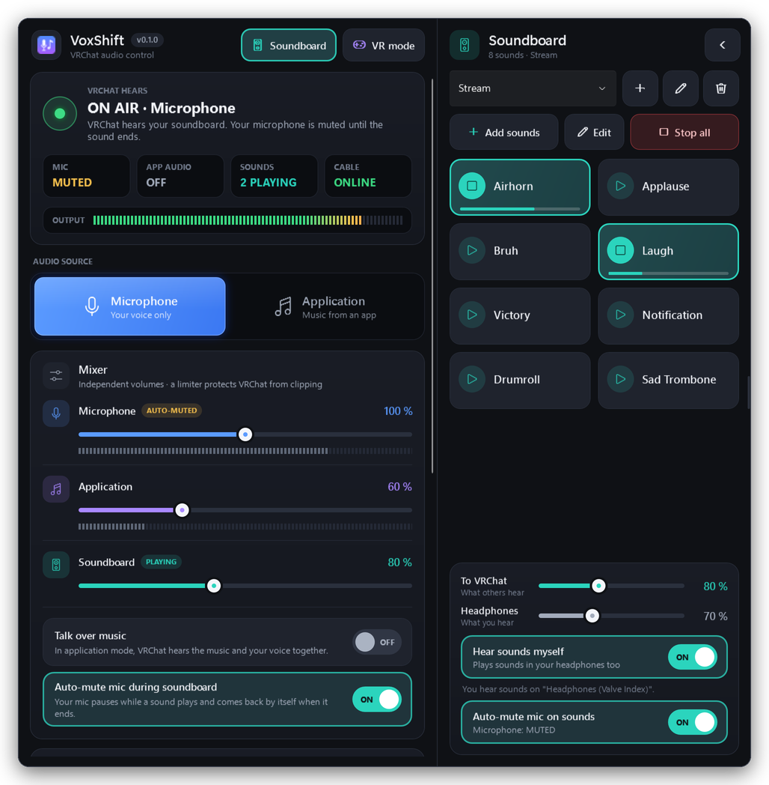
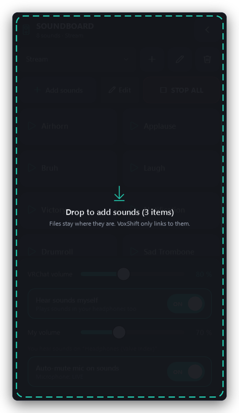
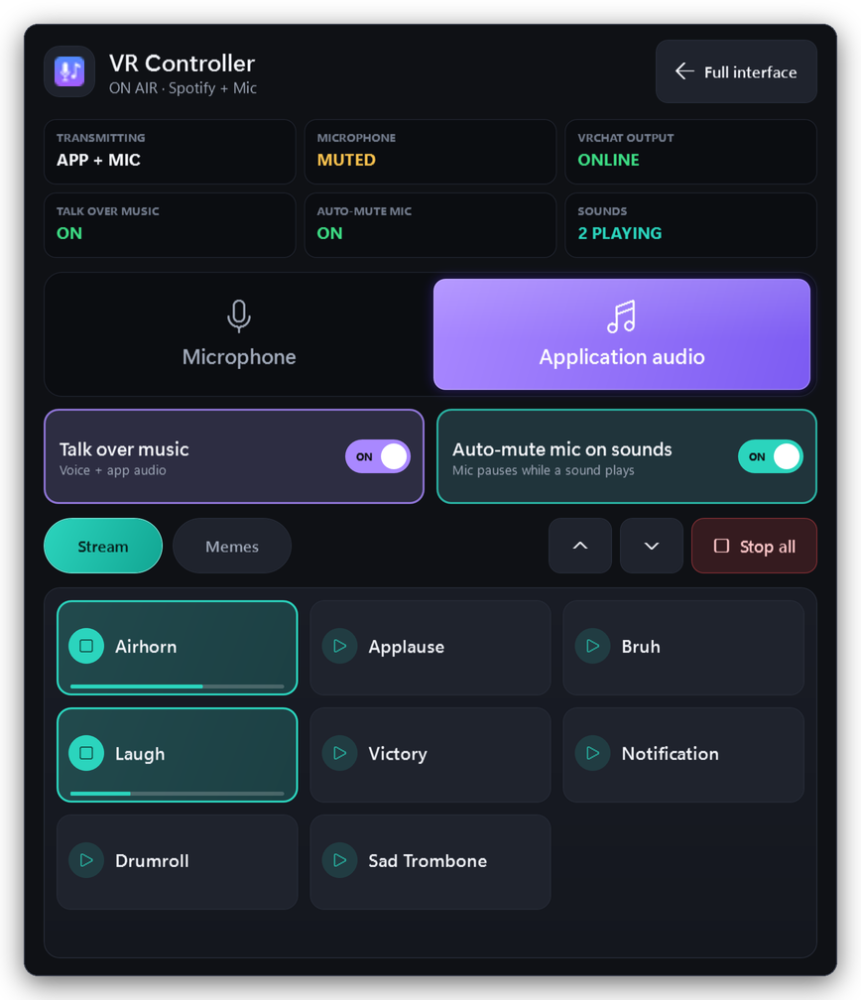
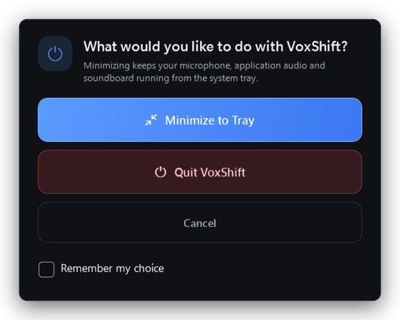

<p align="center">
  
</p>

<h1 align="center">VoxShift</h1>

<p align="center">
  <b>Play music and sound effects into VRChat, and switch between your voice and your music with one click.</b><br>
  A free, open-source audio switcher, mixer and soundboard for VRChat on Windows, built to be usable with VR controllers.
</p>

<p align="center">
  <a href="https://github.com/crapclap161/voxshift/releases/latest"></a>
  <a href="https://github.com/crapclap161/voxshift/actions/workflows/ci.yml"></a>
  
  
  <a href="LICENSE"></a>
</p>

<p align="center">
  <a href="https://github.com/crapclap161/voxshift/releases/latest"><b>Download</b></a> ·
  <a href="#quick-start">Quick start</a> ·
  <a href="#using-voxshift">Using VoxShift</a> ·
  <a href="#troubleshooting">Troubleshooting</a> ·
  <a href="CHANGELOG.md">Changelog</a>
</p>

<p align="center">
  
</p>

<p align="center"><sub>The main window with the soundboard docked on its right. Two sounds are playing, so VoxShift has
muted the microphone automatically; it comes back by itself when they end. All screenshots show the real application
with sample data.</sub></p>

## Contents

- [What is VoxShift?](#what-is-voxshift)
- [Features](#features)
- [Requirements](#requirements)
- [Download](#download)
- [Quick start](#quick-start)
- [Using VoxShift](#using-voxshift)
  - [Microphone and application mode](#microphone-and-application-mode)
  - [Talk over music](#talk-over-music)
  - [Capturing an application](#capturing-an-application)
  - [Mixer and levels](#mixer-and-levels)
  - [Soundboard](#soundboard)
  - [Automatic microphone muting](#automatic-microphone-muting)
  - [VR Controller Mode](#vr-controller-mode)
  - [Tray, closing and startup](#tray-closing-and-startup)
  - [Keyboard shortcuts](#keyboard-shortcuts)
  - [Preferences](#preferences)
- [Troubleshooting](#troubleshooting)
- [Windows security warnings and verifying a download](#windows-security-warnings-and-verifying-a-download)
- [Known limitations](#known-limitations)
- [Privacy and security](#privacy-and-security)
- [Building from source](#building-from-source)
- [Contributing and support](#contributing-and-support)
- [License and acknowledgments](#license-and-acknowledgments)

## What is VoxShift?

VRChat listens to exactly **one microphone**. If you want your friends to hear music or a sound effect, VRChat can
only pick it up through that microphone, which usually means holding a speaker next to it.

VoxShift fixes that. Together with a free virtual audio cable it gives VRChat a *virtual microphone*, and you decide
what goes into it:

- **your voice**, as usual;
- **the audio of one application**, such as Spotify, VLC or a browser;
- **both together**, so you can talk over your music;
- **sound effects** from a built-in soundboard.

It is made for people who DJ, perform, host events or simply like to share music and sounds in VRChat, on a desktop
or in a headset.

## Features

| | |
|---|---|
| **One-click switching** | Choose *Microphone* or *Application* and VRChat hears the change at once. Short fades keep the switch free of clicks. |
| **Talk over music** | Optionally send your voice together with the application's audio, each with its own volume. |
| **Application capture** | Captures one program's audio directly from Windows. You keep hearing it normally and nothing else on your PC is sent. |
| **Soundboard** | Drop audio files onto the soundboard and play them into VRChat. Several sounds can play at once. Files are used where they are; nothing is copied. |
| **Automatic microphone muting** | While a sound plays, your microphone is muted for VRChat only and returns by itself afterwards. |
| **Hear your own sounds** | Soundboard sounds are also played on your headphones, with a separate volume. |
| **VR Controller Mode** | One simplified window with large buttons for VR desktop overlays. |
| **Safe levels** | A limiter keeps loud mixes from clipping; meters show every source and the final output. |
| **Honest status** | The top of the window states in plain words what VRChat hears right now. |
| **Self-recovering** | Follows unplugged microphones, restarted applications and changed Windows devices without a restart. |
| **Out of the way** | Lives in the system tray, with an optional global hotkey. No installer, no account, no network access. |

## Requirements

| | |
|---|---|
| **Operating system** | Windows 11, 64-bit (x64) |
| **Virtual audio cable** | [VB-CABLE](https://vb-audio.com/Cable/) by VB-Audio (free, donationware). Installing it is the only step that needs administrator rights. |
| **Other** | A microphone, and VRChat. VoxShift itself needs no installation and no .NET runtime. |

> [!NOTE]
> Capturing an application's audio uses a Windows API that exists from build 20348 on, which in practice means
> **Windows 11**. Windows 10 is not tested; on it, application capture is unavailable and VoxShift says so.

## Download

**[Download the latest release](https://github.com/crapclap161/voxshift/releases/latest)** and pick one file under
*Assets*:

| File | What it is |
|---|---|
| `VoxShift-vX.Y.Z-win-x64-portable.exe` | The application as a single file. Recommended. |
| `VoxShift-vX.Y.Z-win-x64.zip` | The same executable plus this README, the changelog and the license texts. |
| `SHA256SUMS.txt` | Checksums of both files, to [verify your download](#windows-security-warnings-and-verifying-a-download). |

There is no installer: put the file wherever you like and start it. To update, replace the file; your settings and
soundboards are kept.

> [!IMPORTANT]
> Releases are signed with a **self-signed** certificate. It lets you check that a file is unmodified and was signed
> with the VoxShift release key, but Windows does not trust it on its own and does **not** show a verified publisher,
> so the *“Windows protected your PC”* prompt can still appear.
> [Details and how to verify](#windows-security-warnings-and-verifying-a-download).

## Quick start

Setup takes about ten minutes and is needed only once.

### 1. Install VB-CABLE

VRChat can only listen to a recording device, and an ordinary program cannot create one. VB-CABLE is a small driver
that adds a virtual cable: VoxShift plays audio into one end, VRChat records from the other.

1. Download the driver pack from <https://vb-audio.com/Cable/> and extract the ZIP.
2. Right-click `VBCABLE_Setup_x64.exe`, choose **Run as administrator**, then **Install Driver**.
3. **Restart Windows.**
4. Open *Settings → System → Sound* and make sure your real devices are still selected: **Output** is your headphones
   or speakers (not *CABLE Input*) and **Input** is your real microphone (not *CABLE Output*). The installer sometimes
   changes them.

You now have two new devices: **CABLE Input**, a playback device that VoxShift sends audio to, and **CABLE Output**,
a recording device that VRChat will listen to.

### 2. Start VoxShift

Download the portable EXE (see [Download](#download)) and double-click it. If Windows shows *“Windows protected your
PC”*, see [Windows security warnings](#windows-security-warnings-and-verifying-a-download). If you downloaded the ZIP,
extract it first; do not run the program from inside the archive.

### 3. Choose your devices

Open **Sources & devices** in the main window (it is open by default):

| Setting | Choose |
|---|---|
| **Microphone** | Your real microphone, or leave *Windows default microphone*. The line below it reads *Capturing “…”* when it works. |
| **Application to capture** | The program you want to share, for example Spotify. Start it first if it is not listed. |
| **VRChat output** | Leave it on **Auto-detect**. The line below it reads *Sending to “CABLE Input (VB-Audio Virtual Cable)”*. |

<p align="center"></p>

If VoxShift reports that no virtual audio cable was found, VB-CABLE is not installed yet or Windows has not been
restarted. **Setup help** opens the built-in guide; **Retry now** checks again.

<p align="center"></p>

### 4. Point VRChat at the virtual cable

1. In VRChat, open the **Launch Pad → Settings → Audio & Voice**.
2. Set **Microphone** to **`CABLE Output (VB-Audio Virtual Cable)`**.
3. Turn **Noise Suppression** off while you play music. It treats music as noise and makes it sound thin or choppy.

From now on VRChat hears only what VoxShift sends. You never have to change VRChat's microphone again; all switching
happens in VoxShift.

### 5. Test it

1. Click **Microphone**. The top card shows **ON AIR · Microphone**, and the **OUTPUT** meter moves when you speak.
2. Ask a friend, or use a second account, to confirm that you can be heard.
3. Play something in the application you selected and click **Application**. Your friend now hears the music.

## Using VoxShift

<p align="center"></p>

The card at the top always says what VRChat hears, for example *“VRChat hears Spotify and your microphone.”* The four
tiles below it show each signal:

| Tile | Values | Meaning |
|---|---|---|
| **MIC** | `LIVE`, `MUTED`, `OFF`, `NO DEVICE`, `NOT SENT` | Whether your voice reaches VRChat. `MUTED` means auto-mute is holding it back while a sound plays; `NOT SENT` means the virtual cable is not running. |
| **APP AUDIO** | `LIVE`, `OFF` | Whether the captured application reaches VRChat. |
| **SOUNDS** | `IDLE`, `1 PLAYING`, … | Soundboard sounds playing right now. |
| **CABLE** | `ONLINE`, `WAITING`, `OFFLINE` | Whether VoxShift is sending into the virtual cable. VoxShift cannot see VRChat itself, so `ONLINE` does not tell you whether VRChat is running or set up correctly. |

### Microphone and application mode

| Mode | VRChat hears | Does not hear |
|---|---|---|
| **Microphone** | Your microphone, plus soundboard sounds | The application |
| **Application** | The selected application, plus soundboard sounds | Your microphone |
| **Application** with **Talk over music** | The application and your microphone, plus soundboard sounds | |

Click the **Microphone** or **Application** button, press `Ctrl+1` or `Ctrl+2`, use the tray menu, or switch from
anywhere with the [global hotkey](#keyboard-shortcuts). In the two plain modes the microphone and the application
are never mixed, not even for a moment while switching.

### Talk over music

Turn on **Talk over music** in the mixer card (or press `Ctrl+T`) to send your voice together with the application's
audio. It only has an effect in application mode. Lower the application or raise the microphone until your voice is
easy to understand over the music.

<p align="center"></p>
<p align="center"><sub>Talk over music is on and a sound is playing: the music continues, and the microphone is muted until the sound ends.</sub></p>

### Capturing an application

- The list shows running programs that have a window or an audio session; programs that are playing are listed first.
  It refreshes itself every 10 seconds; the button next to it, or `F5`, refreshes it immediately.
- The whole program is captured, including its child processes. A browser is therefore shared with **all** of its
  tabs and windows. For music, use a desktop player or a separate browser.
- You keep hearing the application as before. The **Application** volume in VoxShift only changes what VRChat hears.
- If the application is closed, VoxShift waits and resumes on its own when it is started again. The choice is
  remembered between sessions.
- Choosing **None** stops capturing.

### Mixer and levels

The mixer has one strip each for **Microphone**, **Application** and **Soundboard**, each with a volume from 0 to
200 %; the microphone and the application also have a level meter. Volumes are independent and only affect what
VRChat hears. All three run through one limiter;
when **LIMIT** lights up next to the output meter, the mix is being turned down to avoid clipping, so lower one of
the volumes a little.

### Soundboard

The soundboard is attached to the right edge of the main window. The **Soundboard** button in the header, or
`Ctrl+B`, shows and hides it; the arrow button in its header collapses it into a narrow strip.

<p align="center"></p>

**Adding sounds.** Drag audio files, or a folder, from Windows Explorer onto the soundboard, or click **Add sounds**.
If you have no soundboard yet, one is created for you. Supported formats are **WAV, MP3, FLAC, M4A/AAC and WMA**.

<p align="center"></p>

**Playing and organizing.**

| To | Do this |
|---|---|
| Play a sound | Click its button. Several sounds can play at the same time. |
| Stop one sound | Click the playing button again, or right-click it → **Stop**. |
| Play a sound again on top of itself | Right-click it → **Play (overlap)**. |
| Stop everything | **Stop all**. |
| Rename, relink, remove, or show a sound in Explorer | Right-click the sound, or turn on **Edit** and click it. |
| Group sounds | Use the collection selector at the top of the soundboard and the buttons next to it to create, rename and delete collections. |
| Set how loud VRChat hears the sounds | **To VRChat** slider. |
| Set how loud you hear them | **Headphones** slider, with **Hear sounds myself** on. |

> [!IMPORTANT]
> VoxShift only stores the **location** of your sound files. It never copies, moves, changes or uploads them, and
> removing a button or a whole collection does not delete a file. If a file is moved or renamed, its button is
> marked as missing; use **Relink file…** to point it at the new location.

Sounds are played on the Windows default playback device so that you can hear them, in addition to being sent to
VRChat. Your microphone is never played back to you.

### Automatic microphone muting

With **Auto-mute mic during soundboard** on (the default), your microphone is taken out of VRChat's audio while any
sound is playing, and returns shortly after the last one has finished.

- Only the audio VoxShift sends to VRChat changes. Windows, Discord and other programs still hear your microphone.
- It follows actual playback, so **Stop all**, a sound that ends early, or a file that fails to play also bring your
  voice back.
- Turn it off in the mixer card, on the soundboard (**Auto-mute mic on sounds**), in VR Controller Mode or in the
  tray menu if you prefer to talk over your sounds.

### VR Controller Mode

Small controls are hard to hit with a VR controller. **VR mode** in the header replaces the main window and the
soundboard with a single window of large buttons.

<p align="center"></p>

- It contains the essentials: mode, **Talk over music**, **Auto-mute**, your soundboard collections and sounds, and
  **Stop all**. Devices and preferences stay in the full interface.
- **Full interface**, `Esc`, the window's close button or the tray menu (**Show full interface**) bring you back.
- To use it in VR, show the window through a desktop overlay such as the SteamVR desktop view, OVR Toolkit,
  XSOverlay or Virtual Desktop, and click with the controller.
- Switching between the two interfaces does not interrupt audio.

> [!NOTE]
> VR Controller Mode is an ordinary Windows window operated through the pointer your overlay provides. VoxShift has
> no SteamVR or OpenXR integration of its own.

### Tray, closing and startup

- The close button asks whether to **Minimize to Tray** (VoxShift keeps running and sending audio) or to **Quit**.
  *Remember my choice* stores the answer; change it later under *Preferences → When clicking the X button*.
- The tray icon opens VoxShift with a click. Its menu switches the mode, toggles *Talk over music*, *Auto-mute* and
  *VR Controller Mode*, and contains **Exit VoxShift**.
- With *Minimize to tray* on (the default), minimizing the window also hides it in the tray.
- Starting VoxShift a second time brings the running window to the front instead of opening another copy.
- `VoxShift.exe --minimized` starts hidden in the tray, as does the *Start in tray* preference. VoxShift has no
  option to start with Windows; add a shortcut to the Startup folder (`shell:startup`) if you want that.

<p align="center"></p>

### Keyboard shortcuts

| Shortcut | Action | Works |
|---|---|---|
| `Ctrl+1` | Microphone mode | Main window, soundboard, VR Controller Mode |
| `Ctrl+2` | Application mode | Main window, soundboard, VR Controller Mode |
| `Ctrl+T` | Toggle Talk over music | Main window, soundboard, VR Controller Mode |
| `Ctrl+B` | Show or hide the soundboard | Main window, soundboard |
| `F5` | Refresh the application list | Main window, soundboard |
| `Esc` | Return to the full interface | VR Controller Mode |
| Global hotkey | Toggle between microphone and application mode | Everywhere, also while VRChat has focus |

The global hotkey is **off by default**. Enable **Global toggle** under *Preferences → Hotkey*; the suggested
combination is `Ctrl+Alt+M`. To change it, click the hotkey box and press a new combination with at least one of
`Ctrl`, `Alt`, `Shift` or `Win`. If another program already uses the combination, VoxShift tells you.

### Preferences

The **Preferences** section at the bottom of the main window is collapsed by default.

| Setting | Default | Effect |
|---|---|---|
| VR Controller Mode | Off | Use the simplified window instead of the full interface. |
| Soundboard dock | On | Show the soundboard next to the main window. |
| Expand soundboard | On | Off keeps only the narrow strip. |
| Auto-refresh every 10 seconds | On | Keep the application list up to date in the background. |
| Always on top | Off | Keep the VoxShift windows above other windows. |
| Minimize to tray | On | Minimizing hides VoxShift in the tray. |
| Start in tray | Off | Start hidden (requires *Minimize to tray*). |
| When clicking the X button | Always ask | Always ask, minimize to the system tray, or quit. |
| Global toggle / hotkey | Off / `Ctrl+Alt+M` | See [Keyboard shortcuts](#keyboard-shortcuts). |
| Open log folder | | Opens the folder that contains `VoxShift.log`. |

Other defaults: microphone 100 %, application 60 %, soundboard 80 %, headphone monitor 70 %; *Talk over music* off;
*Auto-mute* on; *Hear sounds myself* on.

**Where things are stored**

| | |
|---|---|
| Settings and soundboards | `%APPDATA%\VoxShift\settings.json` |
| Log | `%LOCALAPPDATA%\VoxShift\logs\VoxShift.log` (limited to about 1 MB, plus one older file) |

To uninstall, delete the executable and these two folders. VB-CABLE is removed with its own setup program
(`VBCABLE_Setup_x64.exe` → *Remove Driver*).

## Troubleshooting

| Problem | What to do |
|---|---|
| **“No virtual audio cable found”** | Install [VB-CABLE](https://vb-audio.com/Cable/), restart Windows, then click **Retry now**. |
| **Nobody hears anything** | In VRChat the microphone must be *CABLE Output (VB-Audio Virtual Cable)* and you must not be muted there. In VoxShift the top card must say **ON AIR** and the **CABLE** tile **ONLINE**. |
| **Others do not hear me in application mode** | That is how application mode works: it sends the application only. Turn on **Talk over music**. |
| **My voice disappears when I play a sound** | That is [auto-mute](#automatic-microphone-muting). Your voice returns when the sound ends; turn auto-mute off to talk over sounds. |
| **I cannot hear anything on my PC** | Windows made *CABLE Input* the default output. In *Settings → System → Sound*, select your headphones or speakers. VoxShift shows a warning in this situation. |
| **Others hear the music twice, or an echo** | The music program is playing into *CABLE Input* directly. In *Settings → System → Sound → Volume mixer*, set it back to your headphones, and make sure *Listen to this device* is off for *CABLE Output*. Also do not select VRChat itself as the application. |
| **The application is not in the list, or “is not running”** | Start the program, let it play something, then refresh the list (`F5`). |
| **A browser stays silent** | The whole browser is captured, including background tabs, and VoxShift re-attaches within a few seconds when the browser starts its audio process late. If it stays silent, check that the tab is not muted and select the browser again. Copy-protected (DRM) playback is delivered as silence by Windows. |
| **The application meter stays empty** | The program is not playing, is playing protected content, or you selected a different program with the same purpose (for example another browser). |
| **“Access denied” for an application** | The program runs as administrator. Start VoxShift with the same rights, or the program without them. |
| **Music sounds choppy or robotic in VRChat** | Turn off **Noise Suppression** in VRChat. If **LIMIT** is lit in VoxShift, lower a volume. |
| **Microphone error mentioning exclusive mode** | In the Windows sound settings, open your microphone's *Properties → Advanced* and clear *Allow applications to take exclusive control of this device*. |
| **Microphone access denied** | *Settings → Privacy & security → Microphone*: allow desktop apps to access your microphone. |
| **The soundboard has disappeared** | Click **Soundboard** in the header or press `Ctrl+B`. If only a narrow strip is visible, click it. |
| **A sound button is marked as missing** | The file was moved, renamed or deleted. Right-click the button → **Relink file…** |
| **“Unsupported format”** | Convert the file to WAV, MP3, FLAC, M4A/AAC or WMA. OGG and Opus are not supported. |
| **I cannot hear my own sounds** | Turn on **Hear sounds myself** and raise **Headphones**. Your headphones must be the Windows default output device. |
| **VoxShift vanished after I closed it** | It is in the system tray. Click the tray icon. |
| **I am stuck in VR Controller Mode** | Click **Full interface**, press `Esc`, or use the tray menu → **Show full interface**. |
| **The global hotkey does nothing** | Check that **Global toggle** is on. Another program may use the combination; pick a different one. Programs running as administrator can keep keys from reaching VoxShift. |
| **Something else** | *Preferences → Open log folder*, then [open an issue](https://github.com/crapclap161/voxshift/issues/new/choose) and attach `VoxShift.log`. |

## Windows security warnings and verifying a download

**“Windows protected your PC.”** SmartScreen shows this for programs it has not seen often or cannot attribute to a
publisher it trusts. It is not a malware detection. If you downloaded VoxShift from the
[official releases page](https://github.com/crapclap161/voxshift/releases), click **More info**, then **Run anyway**.
The publisher is shown as unknown; that is expected.

**What the signature does and does not prove**

| Question | Answer |
|---|---|
| Is `VoxShift.exe` signed (Authenticode, SHA-256, timestamped)? | Yes, from v0.0.8 on. v0.0.7 and older are unsigned. |
| With what? | A **self-signed** certificate owned by the VoxShift project. The fingerprint of its key is printed in every release's notes. |
| Can I check that a file is unmodified and was signed with that key? | Yes, see below. |
| Does Windows trust the certificate, or show a verified publisher? | **No.** A self-signed certificate is not issued by a public certification authority. |
| Do SmartScreen warnings go away? | **No.** |

Do not install the VoxShift certificate into your Windows trust store. Background and limits are described in
[docs/code-signing.md](docs/code-signing.md).

**Checking a download** (optional). In PowerShell, in the folder that contains the file, using the file name of the
version you downloaded:

```powershell
Get-FileHash .\VoxShift-v0.1.0-win-x64-portable.exe -Algorithm SHA256
```

The result must match the line for that file in `SHA256SUMS.txt` from the same release. To inspect the signature:

```powershell
$s = Get-AuthenticodeSignature .\VoxShift-v0.1.0-win-x64-portable.exe
$s.Status
[BitConverter]::ToString([Security.Cryptography.SHA256]::Create().ComputeHash($s.SignerCertificate.GetPublicKey())).Replace('-', '').ToLower()
```

The second value must equal the *Signing key SHA-256* shown in the release notes. For a self-signed certificate
`Status` is normally `NotTrusted` or `UnknownError`, because Windows does not trust the certificate; that is expected.
`HashMismatch` or `NotSigned` means the file is not the released one: do not run it.

## Known limitations

- **Windows 11, x64 only.** Application capture needs Windows 11; Windows 10 and ARM64 are not tested.
- **A virtual audio cable is required.** VoxShift does not include a driver.
- **Per application, not per tab or window.** A browser is captured with everything it plays.
- **One microphone and one application at a time.**
- **Protected (DRM) audio** may be delivered as silence by Windows.
- **Soundboard:** each sound is limited to five minutes (use application mode for long music); at most 32 sounds play
  at once; a single import handles up to 500 files and does not look into subfolders; OGG and Opus are not supported.
- **Monitoring** of your own sounds always uses the Windows default playback device.
- **One global hotkey**, which toggles the mode. Sounds have no hotkeys.
- **VR Controller Mode** is a desktop window for overlays, not a native VR overlay.
- **A little added delay.** Audio passes through a jitter buffer of about 40 ms in addition to the devices' own
  buffers. This is not noticeable in conversation.
- **English only**, and no automatic updates.
- **Self-signed releases:** Windows shows no verified publisher (see above).
- Behaviour that depends on real audio hardware is checked manually before a release; automated tests cover the
  mixing logic and a device-free smoke test of the real executable.

## Privacy and security

- VoxShift makes **no network connections**. There is no account, no telemetry, no update check and no crash upload.
  The links in the application (VB-CABLE's website, Windows sound settings) only open when you click them.
- Audio is processed in memory and sent only to your local audio devices. Nothing is recorded.
- It runs as a normal user. Only the settings file and the log are written, in the two folders listed above.
- The list of running applications is read to let you choose one. It is not stored, apart from the name of the
  application you select.
- To report a vulnerability, see [SECURITY.md](SECURITY.md).

## Building from source

You need the [.NET 10 SDK](https://dotnet.microsoft.com/download/dotnet/10.0). Building and running the unit tests
works on Windows, Linux and macOS; running VoxShift requires Windows.

```bash
git clone https://github.com/crapclap161/voxshift.git
```

```bash
cd voxshift
```

```bash
dotnet build VoxShift.sln -c Release
```

```bash
dotnet test tests/VoxShift.Core.Tests -c Release
```

```bash
dotnet publish src/VoxShift/VoxShift.csproj -c Release -r win-x64 -o publish
```

`publish/VoxShift.exe` is the same kind of self-contained single-file build as the release, without a signature.
The architecture, the test strategy, the CI workflows and the release process are described in
[docs/development.md](docs/development.md).

## Contributing and support

- **Bugs and ideas:** [open an issue](https://github.com/crapclap161/voxshift/issues/new/choose). For bugs, include
  your Windows version, the VoxShift version and `VoxShift.log`.
- **Code:** read [CONTRIBUTING.md](CONTRIBUTING.md) first. Pull requests are welcome.
- **Security:** report vulnerabilities privately as described in [SECURITY.md](SECURITY.md).
- **History:** [releases](https://github.com/crapclap161/voxshift/releases) and the [changelog](CHANGELOG.md).

## License and acknowledgments

VoxShift is released under the [MIT license](LICENSE), © 2026 crapclap161.

It is built on [NAudio](https://github.com/naudio/NAudio) by Mark Heath and the .NET and WPF runtimes; their licenses
are in [THIRD-PARTY-NOTICES.md](THIRD-PARTY-NOTICES.md). [VB-CABLE](https://vb-audio.com/Cable/) is a separate product
by VB-Audio Software and is not distributed with VoxShift.

<p align="center"><sub>
VoxShift is an independent project. It is not affiliated with or endorsed by VRChat Inc. or VB-Audio Software.
</sub></p>
