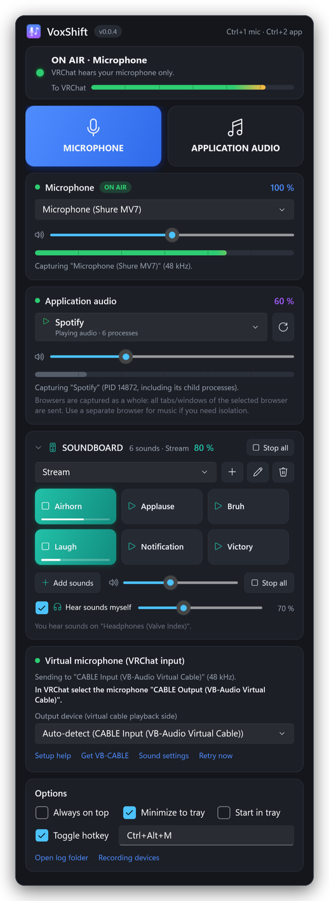

# VoxShift v0.0.3 — Soundboard Feature Release

This is the **VoxShift v0.0.3 Soundboard Feature Release**. Besides switching between your microphone and an
application, VoxShift now has a **local soundboard**: click a button and VRChat hears the sound, mixed with your voice
or with the music you're sharing.

## Highlights

- 🎛️ **Soundboard in the main window.** A collapsible *SOUNDBOARD* section with one button per sound. Click to play,
  click again to stop, or use **Stop all**. Several sounds can play at the same time, and each button shows its
  playback progress.
- 🎤 **Mixed into the virtual microphone.** Sounds are added to whatever VoxShift is sending:
  - Microphone mode: **microphone + soundboard → VB-CABLE → VRChat**
  - Application mode: **application audio + soundboard → VB-CABLE → VRChat**

  As before, microphone and application audio are never sent together. The soundboard is an extra layer on top and
  keeps playing when you switch modes.
- 🖱️ **Drag & drop from Windows Explorer.** Drop audio files (or a folder) onto the soundbar. It is highlighted while
  you drag, also when collapsed. The first drop creates a soundboard automatically, and buttons appear immediately.
- 🗂️ **Multiple soundboards.** Create, rename, delete and switch between collections, e.g. *Stream* and *Memes*.
- 🔊 **Independent soundboard volume** from 0 to 200 %, protected by VoxShift's limiter. The *To VRChat* meter includes
  the soundboard.
- 💾 **Everything is remembered:** collections, buttons, names, volume, the selected collection and whether the
  soundbar is collapsed.

## Drag & drop in 4 steps

1. Open VoxShift and Windows Explorer side by side.
2. Select one or more audio files (WAV, MP3, FLAC, M4A/AAC, WMA), or a folder.
3. Drag them onto the **SOUNDBOARD** section. It lights up as a drop target.
4. Drop. New buttons appear right away. Click one, and VRChat hears it.

You can also use **Add sounds** to pick files with the Windows file dialog.

## Your files stay where they are

VoxShift **does not copy, move, upload or modify** imported audio files. The soundboard stores each file's absolute
path and plays the original file directly from its location. Removing a sound, or deleting a whole soundboard,
**never deletes the audio file**. If a file is moved, its button shows a warning and you can **right-click → Relink
file…** to point it at the new location.

## Install or upgrade

- **New install:** download `VoxShift-v0.0.3-win-x64-portable.exe` and run it. There's nothing to install and no
  .NET needed. You also need the free [VB-CABLE](https://vb-audio.com/Cable/) driver, and in VRChat you select
  **CABLE Output (VB-Audio Virtual Cable)** as your microphone once.
- **Upgrade from 0.0.1/0.0.2:** replace the old EXE with the new one. Your settings (devices, application, volumes,
  hotkey) are kept, and the soundboard starts empty.
- `VoxShift-v0.0.3-win-x64.zip` contains the same EXE plus README, changelog and licenses. Verify downloads with
  `SHA256SUMS.txt`. The EXE isn't code-signed yet, so if SmartScreen appears, choose **More info → Run anyway**.

## Supported formats

| Format | Decoder |
|---|---|
| WAV (PCM 8/16/24/32-bit, float) | VoxShift built-in |
| MP3, FLAC, M4A/AAC, WMA | Windows Media Foundation (built into Windows 10/11) |

Each sound is decoded once and kept in memory (up to 5 minutes per sound, 256 MB cache), so clicks start instantly.

## Known limitations

- **You don't hear soundboard sounds yourself.** They are only sent to VRChat (the virtual microphone). Local
  monitoring is not part of this release.
- **OGG/Opus isn't supported.** Windows has no built-in decoder for it. Convert the files to MP3/WAV/FLAC.
- Sounds longer than 5 minutes are cut at 5 minutes. Use application mode for long music.
- Sounds only play while the virtual microphone (VB-CABLE output) is running. VoxShift shows a hint if it isn't.
- Unchanged from earlier releases: application capture works per application (not per browser tab), and
  DRM-protected audio may be silent.

## Quality

The release build passes 105 unit tests, 40 of them new for the soundboard: mixing, isolation of microphone and
application audio, mode switching while playing, limiter, persistence and migration, and an end-to-end file pipeline
that checks the original file is untouched. It also passes a Windows smoke test that starts the real EXE, imports a
real WAV file through the soundboard, decodes it, resamples it and plays it through the mixer. As with every release,
please report audio issues together with your `VoxShift.log`.

Full details: [README](https://github.com/crapclap161/voxshift#readme) · [CHANGELOG](https://github.com/crapclap161/voxshift/blob/main/CHANGELOG.md)
