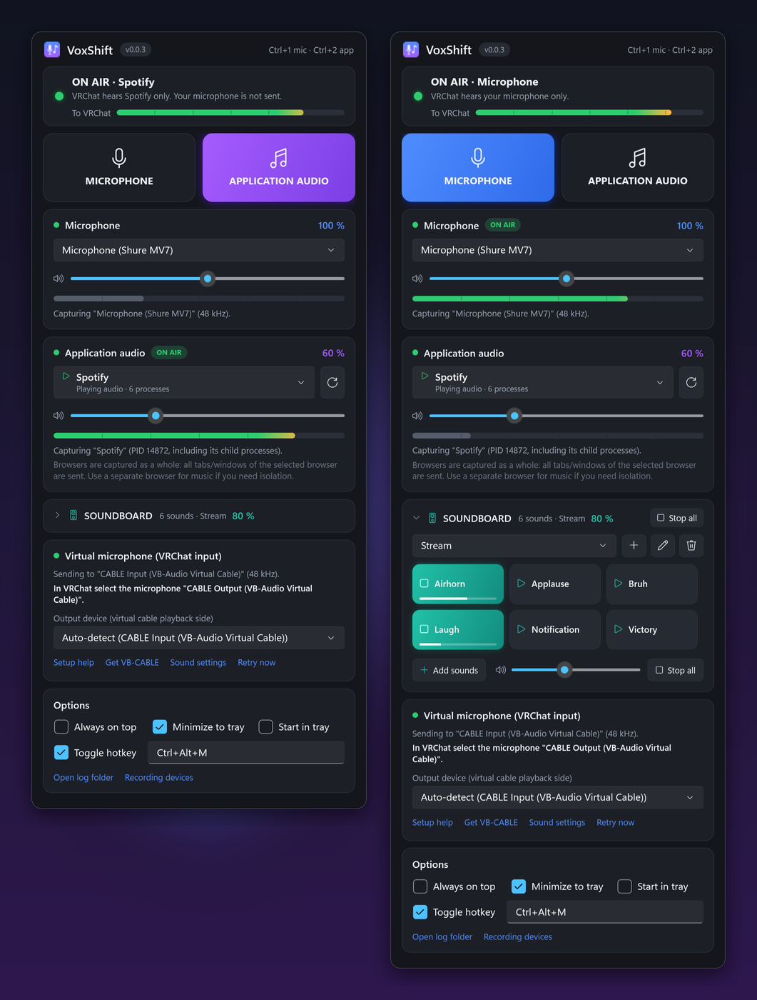
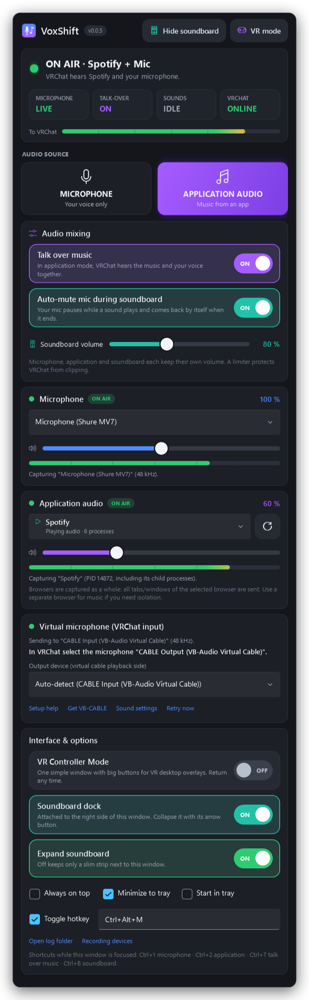
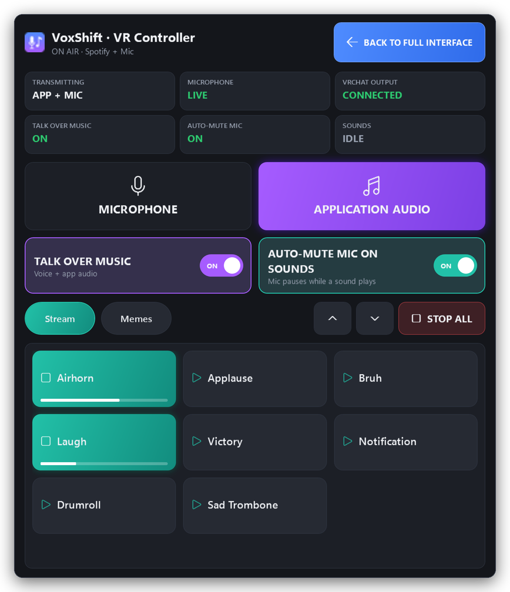
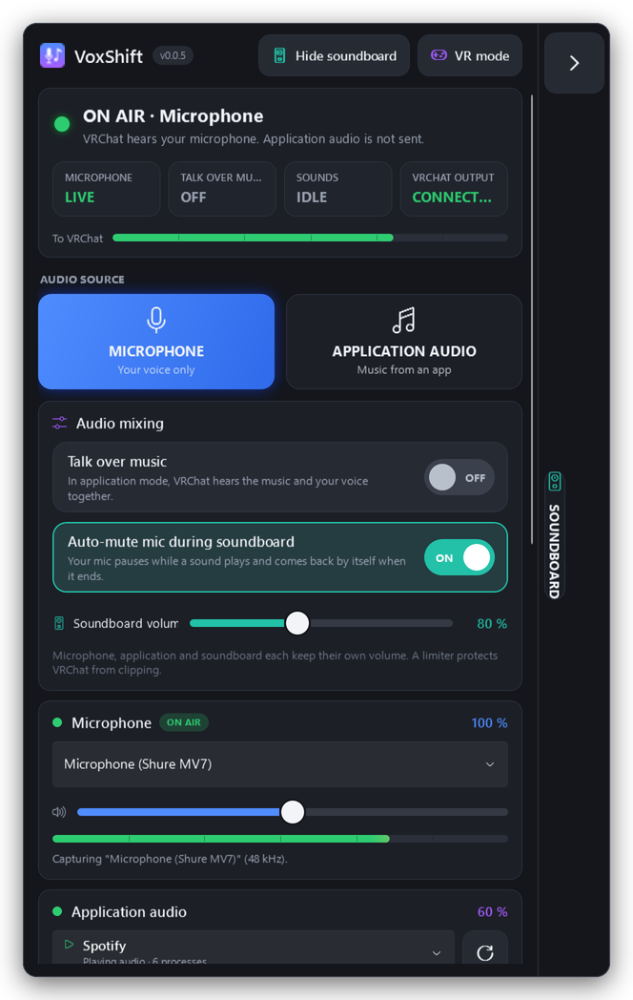
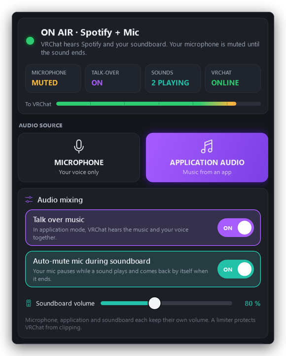

# VoxShift v0.0.5 — VR Control & Smart Audio Update

The biggest VoxShift update so far: a **redesigned, VR-friendly interface**, a **soundboard that docks to the right
of the window**, optional **voice over music**, and **automatic microphone muting while soundboard sounds play**.

## What's new

### 🤫 Smart microphone muting
- Click a sound and VoxShift **mutes your microphone automatically** while it plays. VRChat hears the air horn, not
  your voice over it.
- Your microphone **comes back by itself** as soon as the **last** sound has really finished. No extra clicks.
- Follows the mixer's **real playback state**, not a timer: overlapping sounds, **Stop all**, stopping one sound,
  failed playback and device loss are all handled, so the mic is never left muted by accident.
- Short fades (8 ms out, 30 ms back in) prevent pops; a 100 ms hold stops the mic from flickering between quick clicks.
- Only VoxShift's mix is affected. **Your Windows microphone, Discord and other apps are never touched**, and you still
  hear your sounds in your headphones.
- Setting: **Auto-mute microphone during Soundboard playback**, **on** by default.

### 🎙️ Talk over music
- New **Talk over music** switch (off by default): in application mode, VRChat hears **your music and your voice
  together**, e.g. to DJ or play Spotify while you talk.
- Microphone, application and soundboard keep **independent volumes**; everything passes the −1 dBFS limiter.
- Off = the classic switch. Your microphone never leaks into application mode, and application audio never leaks into
  microphone mode.
- With auto-mute on, a sound pauses **only your voice**. The music keeps playing.

| Mode | Talk over music | Sound playing | Auto-mute | VRChat hears |
|---|:-:|:-:|:-:|---|
| Microphone | – | no | – | microphone |
| Microphone | – | yes | on | soundboard only |
| Microphone | – | yes | off | microphone + soundboard |
| Application | off | no | – | application |
| Application | off | yes | – | application + soundboard |
| Application | on | no | – | application + microphone |
| Application | on | yes | on | application + soundboard (mic muted) |
| Application | on | yes | off | application + microphone + soundboard |

### 🎛️ Dockable soundboard
- The soundboard is now its **own window, attached to the right edge** of VoxShift. It no longer takes space in the
  main window.
- It **follows** the main window when you move or resize it, lines up correctly at any DPI and on any monitor, nudges
  the main window left when there isn't enough room, and never opens off-screen.
- **Collapse** it into a slim strip with a big ▶ handle; **expand** it with one click. Drag & drop works on both.
- Minimizes, restores and hides to the tray together with the main window and follows *Always on top*. Closing the dock
  never closes VoxShift. Its state and width are remembered.
- New **Edit** mode: rename, relink or remove sounds without right-clicking.
- Everything from v0.0.3/v0.0.4 is still there: local file references, collections, overlapping sounds, progress,
  Stop all, VRChat volume, *Hear sounds myself* with its own volume, missing-file handling.

### 🥽 VR Controller Mode
- Optional simplified window for **VR desktop overlays**: huge **MICROPHONE / APPLICATION AUDIO** buttons, **TALK OVER
  MUSIC** and **AUTO-MUTE MIC ON SOUNDS** switches, status tiles, your soundboard as large buttons with **STOP ALL**,
  collection chips and page buttons, and **BACK TO FULL INTERFACE**.
- Switching modes changes only the UI: the audio engine keeps running, nothing is interrupted or duplicated.
- You can't get stuck: the window's X, Esc and the tray's **Show full interface** all lead back.
- Works with any overlay that forwards controller pointing as Windows mouse input (SteamVR desktop, Virtual Desktop,
  OVR Toolkit, XSOverlay …). There is no native OpenXR/SteamVR integration.

### 🖥️ Redesigned interface
- Status card that says exactly what VRChat hears, with large chips for **Microphone (LIVE / MUTED / OFF)**, **Talk over
  music**, **Sounds** and **VRChat output**. They show the *effective* state, not just the settings.
- Bigger mode buttons, a new **Audio mixing** card, large ON/OFF switches, large sliders (click anywhere to jump),
  48 px buttons and pickers, and clear hover, pressed, focus and disabled states.
- New shortcuts: **Ctrl+T** talk over music, **Ctrl+B** show/hide soundboard, **Esc** leaves VR Controller Mode.
  The tray menu can toggle talk over music, auto-mute and VR Controller Mode.

## Screenshots

| | |
|---|---|
|  |  |
|  |  |

All screenshots are rendered from the real WPF UI with sample devices and sounds.

## Upgrade

Replace the EXE with **`VoxShift-v0.0.5-win-x64-portable.exe`**. Settings migrate automatically (schema 4):
devices, volumes, hotkeys, window position, soundboard collections, file references and headphone monitoring are all
kept. The soundboard opens in the dock (visible and expanded if you already use it), **Auto-mute starts on**, **Talk over
music starts off**, and the full interface is shown. Verify downloads with `SHA256SUMS.txt`. The EXE isn't code-signed
yet, so if SmartScreen appears, choose **More info → Run anyway**.

## Known limitations

- VR Controller Mode relies on your VR overlay's mouse emulation; VoxShift has no native OpenXR/SteamVR/Meta
  controller integration.
- The dock always sits on the right of the main window. On very narrow screens, or with a maximized window, it overlaps
  the main window instead.
- Auto-mute only reacts to soundboard sounds sent to VRChat. With the virtual cable stopped, nothing is transmitted
  anyway.
- Unchanged: OGG/Opus isn't supported, sounds are cut at 5 minutes, monitoring uses the Windows default playback device,
  application capture works per application (not per browser tab), and a virtual audio driver (VB-CABLE) is required.

## Quality

169 unit tests pass (52 new: the full behaviour matrix, auto-mute timing and edge cases, leakage checks, limiter and
metering with all three sources, settings migration and dock placement). Every release is also smoke-tested on
Windows: the real EXE starts, plays a soundboard file, verifies talk over music and auto-mute, shows the docked
soundboard, switches to VR Controller Mode and back without restarting the audio engine, and performs a real
process-loopback capture.

Full details: [README](https://github.com/crapclap161/voxshift#readme) · [CHANGELOG](https://github.com/crapclap161/voxshift/blob/main/CHANGELOG.md)
