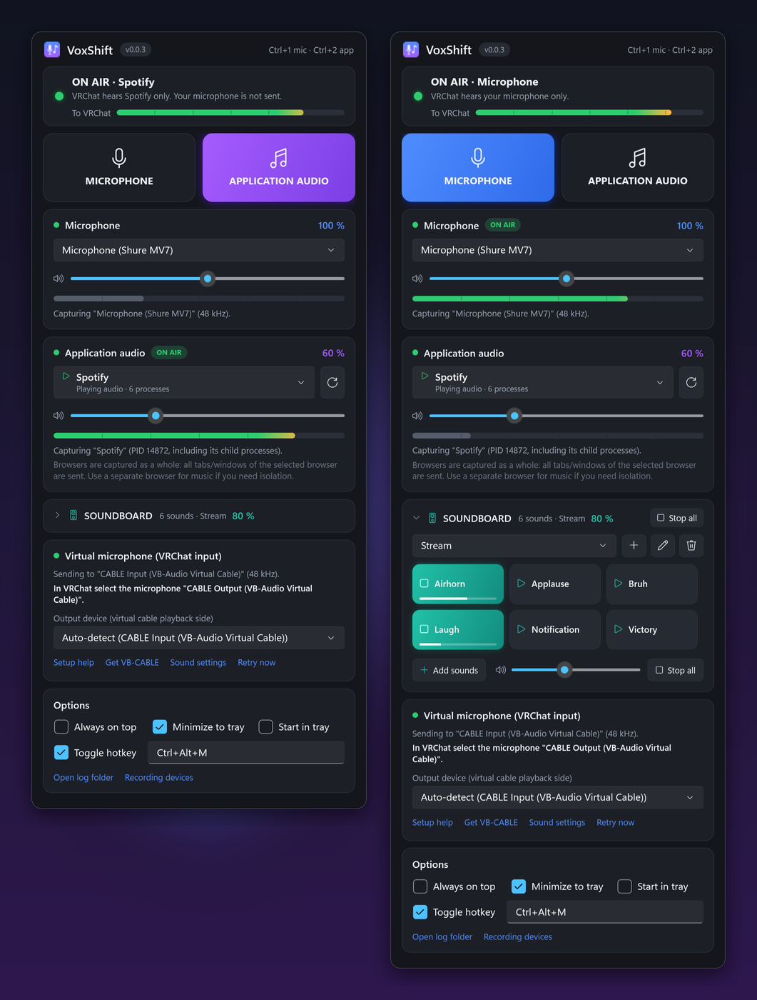
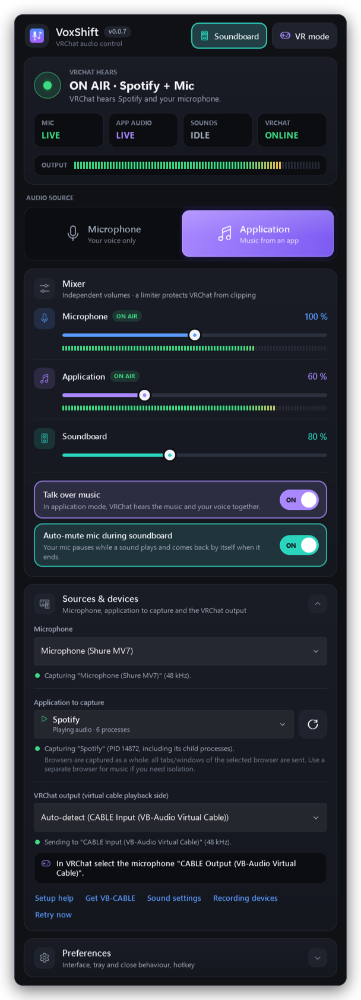
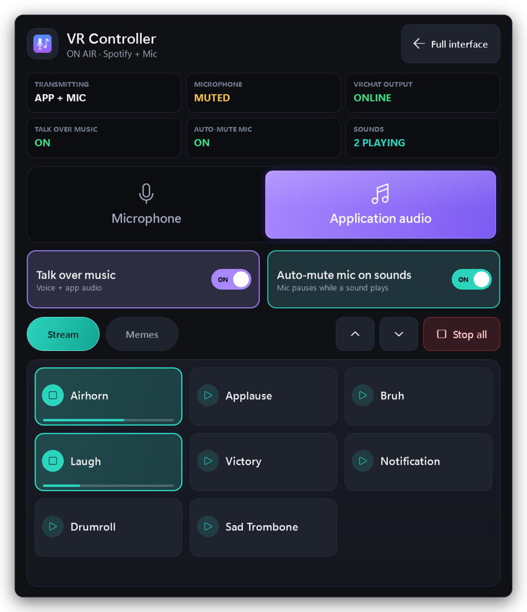

# VoxShift v0.0.7 — UI/UX Overhaul

VoxShift has a new interface. Every window – the main window, the docked soundboard, VR Controller Mode and the
dialogs – was redesigned on one shared design system. Audio routing, mixing, hotkeys and your settings are unchanged.

## What's new

### A dashboard instead of a long form
- **Live status at the top:** one sentence for what VRChat hears, four tiles (**Mic**, **App audio**, **Sounds**,
  **VRChat**) and the output level meter.
- **Audio source** is one segmented switch: **Microphone** or **Application**.
- **Mixer:** one strip each for microphone, application and soundboard with a slider, its value, a live meter and
  ON AIR / AUTO-MUTED / PLAYING badges, followed by **Talk over music** and **Auto-mute mic during soundboard**.
- **Sources & devices** (device and application pickers) and **Preferences** (interface, tray, close button, hotkey)
  are collapsible sections, so what you need while playing fits without scrolling.
- Setup and warning messages appear directly under the live status.
- The header's **Soundboard** switch lights up while the dock is shown.

### Soundboard
- Sound pads with a play badge and an unmistakable playing state: teal wash, ring and a progress bar.
- Volumes are labelled by where they go: **To VRChat** (what others hear) and **Headphones** (what you hear).
- Redesigned empty state, collapsed strip, drag-and-drop overlay, Edit toggle and **Stop all**; the width grip is
  now visible.

### VR Controller Mode
- Same look, sized for controllers: a recessed source switch with large lit buttons, clearer status tiles, larger
  collection chips and a **Full interface** button (Esc still works).

### Everywhere
- New layered dark palette with refined blue / violet / teal accents, display typography, consistent focus rings
  and subtle hover and press transitions.
- Segmented LED-style level meters.
- Close confirmation, setup help (numbered steps) and the rename prompt match the rest of the app.

| | |
|---|---|
|  |  |

## Good to know
- Nothing to migrate: settings, soundboard collections, hotkeys and the close-button preference carry over.
- Some labels changed: *APPLICATION AUDIO* is **Application**, *VRChat volume* / *My volume* are **To VRChat** /
  **Headphones**, *BACK TO FULL INTERFACE* is **Full interface**, *Interface & options* is **Preferences**.
- The main window's minimum size is now 480 × 520.

## Downloads
- `VoxShift-v0.0.7-win-x64-portable.exe` (single file, no installer)
- `VoxShift-v0.0.7-win-x64.zip`
- `SHA256SUMS.txt`
